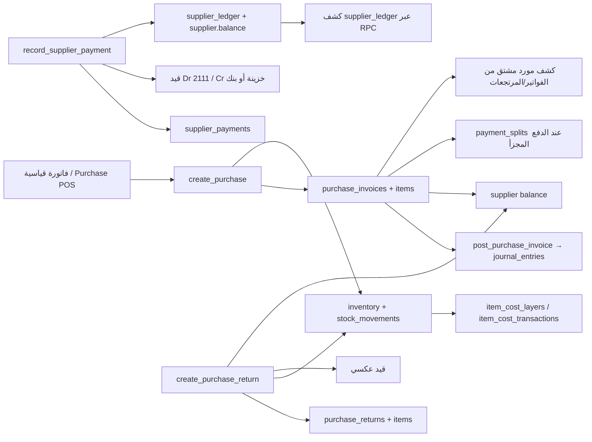

# Vortex ERP (Market Hub) — تدقيق نظام المشتريات وخطة التطوير المؤسسية
> **وثيقة اكتشاف وتدقيق وتخطيط فقط — مسودة للمراجعة**  
> إعداد: 2026-11-01 | الفرع: `main` | Commit: `a2171fc0c2f12907c2e143278c6b50d43d2d1a4e`  
> **لم يبدأ أي تطوير وظيفي أو تعديل قاعدة بيانات. لا يجوز بدء التنفيذ قبل موافقة صاحب المشروع صراحةً.**

## فهرس
1. الملخص التنفيذي
2. النطاق والمنهجية والقيود
3. خريطة النظام
4. جرد الوظائف
5. الفجوات التفصيلية
6. الموردون
7. الفواتير والدفعات والسيناريوهات
8. أوامر الشراء والاستلام والمطابقة
9. المخزون والتتبع
10. المحاسبة
11. التكرار والتبسيط
12. المتطلبات بحسب الأولوية
13. مراحل التطوير المقترحة
14. خطة الاختبارات
15. ترحيل البيانات والتوافق
16. الأمن والصلاحيات
17. قرارات صاحب المشروع
18. الخلاصة وخارطة الطريق
19. المراجع
---

## 1. الملخص التنفيذي
المشروع هو نظام **Vortex ERP (Market Hub)** لتجارة التجزئة والجملة وإدارة المنتجات والمشتريات والمبيعات والمخزون والمالية. الشيفرة تؤكد استخدام React 19 وTypeScript وTanStack Start/Router، وSupabase Auth/PostgreSQL وRLS وRPC بـ PL/pgSQL. توجد نواة مشتريات تشغيلية فعلية وليست مجرد شاشات: فواتير شراء مؤكدة تنشأ عبر RPC، تدخل المخزون للسلع المتتبعة، تسجل الفواتير والمرتجعات محاسبيًا في مسارات متقدمة، وتوجد سجلات مستقلة لصرف الموردين ودفتر موردين وتجزئة دفع.

**لكن النضج غير متجانس:** النموذج سريع ويجمع الإنشاء والترحيل والاستلام في فاتورة واحدة؛ لا تظهر دورة طلب شراء/أمر/استلام/فاتورة ومطابقة ثلاثية. توجد سندات صرف ودفتر موردين في SQL وواجهة منفصلة، لكن المسارات لا تتطابق بين دفتر الموردين البديل الذي يشتق الحركات من الفواتير والمرتجعات، وبين الدفتر الجدولي الذي يضم حركات السداد المنفصلة. سند الصرف غير مخصص لفاتورة، ولا يوفر سجل الدالة الظاهر إلغاءً/عكسًا. واجهة كشف المورد في الدليل تعرض آخر 30 فاتورة وآخر 30 دفعة فقط.

أبرز المخاطر المؤكدة: تعريفات مختلفة متراكبة لـ `create_purchase` عبر سلسلة migrations مع استدعاءات واجهة متعددة التواقيع؛ خلط حركة المخزون وإثبات الفاتورة في حدث إدخال واحد، فلا يوجد فصل موثق لاستلام مستقل أو GR/IR؛ وجود مصدرين/ثلاثة لموقف المورد (حقل balance، جدول supplier_ledger، وكشف مشتق من الفواتير والمرتجعات)؛ سندات الصرف لا تخصص للفواتير، فيما كشف آخر يصف المدفوع داخل فاتورة على أنه حركة مشتقة بتاريخ الفاتورة؛ صلاحيات مالية متفاوتة بين RLS لـ supplier_ledger/payments و`SECURITY DEFINER`؛ ولا يوجد سجل أرقام تسلسلية رغم وجود نوع tracking SERIAL، والواجهة تعطل اختياره.

الأولوية المقترحة: (P0 مشروط بالتحقق التطبيقي) تثبيت مصدر الحقيقة والمصالحة المحاسبية/الموردية ومنع قنوات الكتابة غير المتسقة؛ ثم (P1) توحيد مدفوعات المورد والتخصيص والعكس، واستكمال بيانات الفاتورة وشروط الاستحقاق وسجل المورد؛ ثم دورة أمر/استلام اختيارية تناسب حجم المنشأة؛ ثم تقارير الأعمار والمطابقة والتتبع المتقدم بحسب النشاط.

**قرارات مطلوبة:** سياسة اعتبار invoice `paid` المضمنة مقابل voucher مستقل؛ هل تعتبر المشتريات الحالية فاتورة مورد أم إيصال شراء نقدي؛ العملات والضرائب والفروع؛ اعتماد الاستلام/الفواتير/الدفعات؛ وهل نحتاج PO/RFQ أو تكفي فاتورة مباشرة افتراضيًا.

> الدليل في المصدر يثبت تعريفات migrations لا الحالة المنشورة على قاعدة إنتاج بعينها. لم أقرأ بيانات فعلية ولم أشغل أي SQL أو RPC.

## 2. النطاق والمنهجية والقيود
- تمت مراجعة بنية المستودع وREADME ومركز الوثائق وملفات `src/routes`, `src/components/invoices`, `src/components/purchases`, `src/lib/statements`, `src/lib/reports`، إضافة إلى ملفات SQL ذات الصلة في `supabase/migrations` وملفات اختبارات seed.
- تم تتبع إنشاء فاتورة الشراء من `StandardInvoiceComposer` وPurchase POS إلى `create_purchase` ثم `purchase_invoices/items` و`post_stock_delta` و`post_purchase_invoice`، وتتبع المرتجع وسند الصرف وكشف الموردين والتقارير.
- تم فحص التعريفات المخزنية والفهارس والسياسات المكتوبة وRPCs الظاهرة في migrations. لا يمكن استنتاج المخطط المنشور فعليًا من المصدر وحده، كما أن ترتيب سلسلة migrations المتعددة يتطلب تشغيلها على قاعدة محلية مؤقتة لفهم الحالة النهائية؛ لم أشغل قاعدة أو ترحيلات في هذه المهمة.
- تمت قراءة اختبار SQL `supabase/seeds/04_tests/accounting-phase4-supplier-tests.sql`، ولم تُشغّل اختبارات أو lint. لا توجد اختبارات TypeScript مخصصة واضحة لدورة الشراء أو تخصيص مدفوعات الموردين. اختبارات محرك كشف الحساب عامة وبعض اختبارات الحسابات لا تثبت صحة تكامل DB.
- لا توجد بيانات حية ولا صلاحية تحقق من إعدادات شركة فعلية أو مخطط production أو سياسات منشورة أو المستندات والمرفقات؛ لذلك نتيجة هذه العناصر «غير متحقق» لا «غير موجودة».
- درجات الأدلة: **مؤكد** = نص/منطق مباشر؛ **مرجح** = مسار جزئي أو تعدد إصدارات؛ **غير متحقق** = لا دليل كافٍ/يعتمد على قاعدة مطبقة.

### التقنيات وطريقة العمل
| المجال | الواقع الذي يثبته المستودع |
|---|---|
| واجهة / لغة | React 19 وTypeScript؛ TanStack Start وRouter وTailwind. |
| إدارة الحالة/البيانات | حالة React محلية مع React Query في بعض الشاشات، Supabase JS مباشرة من الواجهة، وServer Functions لتقارير محددة. |
| النماذج | مكونات نماذج مخصصة؛ React Hook Form/Zod متاحان بالمشروع، ولا يثبت ذلك استخدامهما في نموذج الشراء. |
| قاعدة البيانات | PostgreSQL عبر Supabase، migrations SQL وRLS وPL/pgSQL RPC. |
| المصادقة/الصلاحيات | Supabase Auth، أدوار SQL مثل owner/manager/accountant/warehouse/cashier، ModuleGuard بالواجهة، وسياسات RLS. |
| المعاملات | دوال PostgreSQL تنفذ مستندًا وحركاته في معاملة الاستدعاء؛ الذرية لا تضمن وحدها منع إعادة المحاولة من العميل. |
| الترقيم | `fn_next_document_number` وتسلسلات PostgreSQL؛ أرقام مستندات الشراء/المرتجع/الدفع معرفة في المحرك. |
| النقد/التقييم | أنواع PostgreSQL `numeric`; كميات 3 منازل؛ تقييم متوسط متحرك عبر `item_cost_layers` وحركات موثقة. |
| التقارير والطباعة | سجل تقارير ومزودات وخادم Function مع Zod؛ طباعة موحدة/PDF موجودة بالمشروع. |
| الاختبار | ملفات اختبارات TypeScript مستقلة وseed SQL للتحقق؛ لا suite مشتريات متكاملة مثبتة. |
| سجل التدقيق | `audit_logs` ومداخل من RPCs في عمليات الشراء/المرتجع/الدفع. |

## 3. خريطة النظام الحالي

| المجال | المسؤولية/الدليل |
|---|---|
| واجهات المشتريات | `src/routes/_app.purchases.tsx`, `_app.purchase-invoice.tsx`, `_app.purchase-pos.tsx`; عرض فواتير سريع/قياسي وإنشاء مباشر. |
| منسق الفاتورة | `src/components/invoices/standard-invoice-composer.tsx`; إنشاء عبر RPC `create_purchase`، يتضمن وحدة الشراء/دفعة/صلاحية، وتفاصيل التسوية تحدث لاحقًا على صف الفاتورة. |
| قاعدة المشتريات | `purchase_invoices`, `purchase_invoice_items`, `purchase_returns`, `purchase_return_items` معرفة في `07_purchasing_and_returns.sql`; أعمدة numeric ومفاتيح أرقام فريدة. |
| الدفع المجزأ | `payment_splits` في migration 65، قيد deferred يطابق مجموع الأجزاء مع `paid`؛ يمنع الكتابة المباشرة ويقيد الإدخال عبر RPC. |
| دفتر الموردين | `supplier_ledger`, `supplier_payments`, `record_supplier_payment`, triggers/backfill، `get_supplier_statement` في migration 28. |
| المخزون/التكلفة | `inventory`, `stock_movements`, `product_batches`, `item_cost_layers`, `item_cost_transactions` في `05_products_and_inventory.sql`; `post_stock_delta` في `9901`. |
| الموردون | `suppliers` في `04_partners_customers_suppliers.sql`; بيانات أساسية وbalance وis_active وكيان نظامي. |
| مرتجعات الشراء | `src/routes/_app.purchase-returns.tsx`; RPC `create_purchase_return`; التحقق الدقيق من سطر الفاتورة والوحدة والكمية في `9903`، والدفعات في 81/9903. |
| التقارير | `src/lib/reports/registry/index.ts`, `data-providers/purchase-register.ts`, `report-execution.functions.ts`; سجل مشتريات و«مستحقات الموردين» يستخدمان مزود سجل الشراء. |
| الأمان | سياسات RLS في `13_foreign_keys_and_grants.sql`، تضييق صلاحيات المالية في migration 49 و`36_security_advisor_remediation.sql`. |

### تدفق الإنشاء الفعلي
الشراء القياسي ينشئ رأس فاتورة بحالة `confirmed` مباشرة، يثبت البنود، ويسجل استلامًا فوريًا لكل بند `STOCK_RECEIPT` عبر `post_stock_delta`. بعدها يسجل splits إن وجدت، يزيد balance للمورد بالمتبقي، يضيف audit، وينادي `post_purchase_invoice` في نفس RPC. لا يوجد رأس طلب/أمر أو استلام مستقل في مسار الواجهة/SQL الذي تمت مراجعته. حقل الفاتورة `paid` يجمع المدفوع مع الفاتورة عند الإنشاء، بينما سندات الصرف المستقلة لها جدول ومسار آخر.

## 4. جرد الوظائف الحالية
| الوظيفة | الحالة | الأدلة | الثقة | الملاحظات/المخاطر |
|---|---|---|---|---|
| بطاقة المورد والاتصال والحالة | موجودة ومكتملة للحد الأساسي | `supplier-form-dialog.tsx` حقول الاسم/الهاتف/البريد/العنوان/نشط؛ جدول suppliers. | مؤكد | لا تثبت حقول التصنيف/الرقم الضريبي/البنك/شروط الدفع/الائتمان. |
| إنشاء فاتورة شراء متعددة البنود | موجودة فعليًا | `StandardInvoiceComposer`; `create_purchase` في `9903_uom_transaction_posting.sql`. | مؤكد | الفاتورة مؤكدّة وتؤثر في المخزون/الأستاذ ضمن نفس العملية. |
| وحدات شراء وتحويل للوحدة الأساسية | موجودة في المصدر | migrations 9902/9903 ولقطات الوحدة والكميات/الأسعار. | مؤكد بالمصدر، غير متحقق على DB | يلزم التأكد من النشر/التوافق. |
| مصروف فاتورة/سلعة/خدمة | موجود جزئيًا | `resolve_purchase_line`, `line_type`, `stock_effect`; `post_purchase_invoice` يوجه stock إلى حسابات الصنف أو المصروف. | مؤكد | إعداد الحسابات/الضريبة وسياسات المنشأة التفصيلية غير متحققة. |
| الترقيم الفريد | موجود | `14_document_numbering_engine.sql`, sequence وunique invoice_number. | مؤكد | لا يعوض مفتاح idempotency لمنع إعادة الطلب. |
| الدفع المجزأ عند إنشاء فاتورة | موجود | `payment_splits`, قيود `65`؛ توقيع `_payment_splits` في `80` و`9903`. | مؤكد | تدفق دفع داخل الفاتورة فقط؛ ليس تخصيص سند مستقل لفواتير متعددة. |
| سند دفع مورد منفصل | موجود في SQL/واجهة | `supplier_payments`, `record_supplier_payment`, `/supplier-ledger`. | مؤكد جزئيًا | لا تخصيص لفاتورة، حالة اعتماد/إلغاء غير ظاهرة؛ تفاصيل cashbox/bank محفوظة بعد إنشاء RPC بتحديث إضافي من الواجهة. |
| دفتر المورد | موجود في SQL | `supplier_ledger`, source_key، triggers/backfill، statement RPC. | مؤكد كتعريف مصدر | لا يتطابق مع statement adapter البديل الذي يشتق من الفواتير والمرتجعات. |
| كشف المورد الموحد | موجود بأكثر من مسار | `_app.supplier-ledger.tsx`; `statements/adapters/supplier.ts`; `debts.ts`. | مؤكد | كل مسار يعرض مصدرًا مختلفًا، ما يخلق اختلافات وفروقات. |
| أعمار ديون الموردين | موجودة مشتقة | `src/lib/statements/debts.ts`؛ إعادة استخدام aging algorithm على بيانات مشتقة. | مؤكد جزئيًا | لا يرى supplier_payments المستقلة في adapter؛ لا تخصيص دقيق لأقدم فاتورة بسداد voucher. |
| مرتجع شراء مرتبط بالفاتورة | موجود | UI يختار فاتورة/سطر؛ RPC `create_purchase_return`; guards في 81/9903. | مؤكد | مبلغ الاسترداد النقدي مقابل إشعار دائن غير مفصول كحالة تسوية واضحة. |
| دفعات/صلاحية الأصناف | موجودة | product_batches؛ migrations 80/81؛ إعداد FEFO/FIFO للانتقاء المخزني. | مؤكد بالمصدر | ليست تقييم تكلفة FIFO؛ جودة/حجر/حجز غير متحقق. |
| أرقام تسلسلية | نوع schema فقط وغير متاحة تشغيليًا | enum `item_tracking.SERIAL`; واجهة المنتجات تعرض الخيار disabled؛ لا يوجد جدول serial مطابق في migrations التي فُحصت. | مؤكد لعدم الإتاحة في الواجهة، غير متحقق لقاعدة منشورة | لا يمكن تتبع جهاز فريد/ضمان. |
| PO/RFQ/طلب داخلي/GR مستقل | غير موجود في مسار التنفيذ المفحوص | البحث في واجهات/routes وم migrations لم يجد جداول أو RPCs لهذه الدورة؛ doc-number engine يحجز أنواعًا مستقبلية فقط. | مؤكد في المصدر الذي تمت مراجعته | الترقيم لا يثبت وجود المستند الوظيفي. |
| تقرير سجل المشتريات | موجود | `REPORT_PURCHASES_REGISTER`, provider وserver execution. | مؤكد | تقرير بنود شراء؛ لا يثبت أعمارًا/مطابقة/انحرافات. |
| تقرير التزامات المورد | موجود جزئيًا | `REPORT_SUPPLIERS_PAYABLES` يعيد استخدام `dp-purchase-register`. | مؤكد | grain بند/فاتورة ويعرض `total`؛ لا يجمع صافي الرصيد/التخصيص/الرصيد المستحق لكل فاتورة بشكل موثق. |
| اختبار supplier ledger | موجود كمثبت SQL | `accounting-phase4-supplier-tests.sql`. | مؤكد | يتطلب إدخال/حذف بيانات عند التشغيل، لذلك لم يُشغّل، ولا يغطي سيناريوهات الدفع المطلوبة. |
| صلاحيات قراءة/كتابة للمورد | موجودة ومتباينة | `13`، `49`, `36`; RPC roles. | مؤكد بالمصدر | اختلاف عام staff لإدارة الفواتير عن finance-only لقراءة دفتر المورد. |
| عملات متعددة/FX/مطابقة ضريبية | غير متحقق/لا دليل كافٍ في مسار الشراء | أعمدة الفاتورة الأساسية لا تحتوي عملة/سعر صرف في تعريف `07`؛ قد توجد توسعات لاحقة لم تثبتها القراءة الشاملة النهائية. | غير متحقق | يلزم بحث schema النهائي والسياسات المحلية قبل التصميم. |
| مرفقات/عقود/تقييم أداء المورد | غير متحقق | لم يظهر مسار متكامل في الملفات المفحوصة. | غير متحقق | لا تصنف مفقودة كليًا قبل مسح storage/وحدات الإعداد كاملة. |

## 5. الفجوات التفصيلية
### G-01 — نموذج فات واحد يقوم بدور الأمر والاستلام والفاتورة (P1)
- **الوضع/الدليل:** الواجهة القياسية ترسل بنودًا مباشرة إلى `create_purchase`؛ `9903` يضع الحالة `confirmed`، يدخل البنود ويستدعي `post_stock_delta` ويثبت القيد. `80` يقوم بالنمط نفسه. لا يوجد فصل موثق لأمر شراء واستلام وفاتورة. مصدر `07` يثبت أن رأس الشراء يحوي supplier/warehouse/status/totals/paid/payment_method فقط، دون تواريخ استحقاق/مرجع فاتورة المورد/عملة.
- **المتوقع:** يدعم النظام مسارًا بسيطًا «فاتورة/استلام مباشر» كافتراضي، ومسارًا اختياريًا PO → استلام → فاتورة؛ لا تزداد الكمية ولا الذمم عند مجرد أمر شراء. الاستلام يضيف المخزون مرة واحدة، والفاتورة تثبت المطلوب المالي وفق سياسة المنشأة، مع فصل الاستلام غير المفوتر عند الحاجة.
- **الأثر:** لا يمكن تسجيل وصول جزئي موثق قبل الفاتورة، ولا تعدد فواتير مرتبطة بأمر أو استلامات منفصلة. احتمال عدم مطابقة استلام البضاعة بفاتورة المورد. لا نثبت أن هذا أدى إلى خسارة حالية لأن لا بيانات إنتاجية فُحصت.
- **الحل/الاعتمادية:** مرحلة PO والاستلام تكون خيارًا/Feature بحسب خطة المنشأة؛ ربطها بمخزون `post_stock_delta` الحالي وبـ UOM/دفعات، لا إعادة كتابة محرك المخزون. تتطلب قرار تعريف المستند الافتراضي.
- **معايير القبول:** أمر بلا استلام لا يغير inventory ولا الذمم؛ استلام جزئي ومتكرر لا يتجاوز المتبقي؛ فاتورة مرتبطة لا تسجل استقبالًا مكررًا؛ استلام مباشر متاح لمن لا يريد PO؛ الإلغاء يعكس الأثر بسند عكسي لا حذف.

### G-02 — حقل `paid` في الفاتورة لا يمثل سجل دفعات مستقل (P1)
- **الدليل:** `purchase_invoices.paid` مبلغ إجمالي؛ `supplier_ledger` trigger يكتب credit بكامل total وdebit بقيمة paid عند INSERT، كلاهما بتاريخ إنشاء الفاتورة. `record_supplier_payment` ينشئ voucher منفصل لكنه لا يحوي invoice_id/allocation relation. `statements/adapters/supplier.ts` يتجاهل supplier_ledger/payments ويشتق payment من paid بتاريخ الفاتورة. بذلك يمكن أن تختلف شاشة/تقرير عن سندات الصرف الفعلية.
- **المطلوب:** دفتر حركة واحد موحد يتضمن invoice, payment, credit note, advance والتخصيصات، تواريخ حدث حقيقية، وتوازن فواتير/سندات/مورد. التخصيص many-to-many بمبالغ numeric وقيود تمنع الإفراط.
- **معايير القبول:** كل سند ظاهر مرة واحدة في كشوف المورد والتقارير؛ لا ينشأ أثر دفع ثانٍ عند ترحيل invoice paid؛ مجموع التخصيصات لا يتجاوز سند الدفع أو الدين المتاح؛ قيود المقدمات تظل أصلًا/دفعة مقدمة حتى تسويتها.

### G-03 — لا يوجد تخصيص سند الصرف إلى فاتورة (P1)
- **الدليل:** `supplier_payments` يحوي supplier/amount/method/account/date/journal_entry_id ولا invoice mapping. UI `/supplier-ledger` يختار المورد والمبلغ فقط؛ تسميات تشير إلى «تحت الحساب/فاتورة رقم» في notes لكن لا تخصيص هيكلي. لا يمكن تحديد invoice balances بدقة من vouchers.
- **الحل:** allocation table/ledger references بعلاقة متعددة، لا حقل invoice واحد في voucher. سند واحد لعدة فواتير وعدة سندات لفاتورة. الغير مخصص يبقى رصيدًا مقدمًا للمورد، ويظهر كعنصر مستقل حتى التخصيص.
- **قبول:** أمثلة القسم 7، مع قيود تمنع allocations تتجاوز المبلغ والفاتورة، والتعامل مع credit notes والاسترداد.

### G-04 — ثلاث مرجعيات لرصيد المورد (P0 خطر مصالحة، لا دليل على فساد فعلي)
- **الدليل:** `suppliers.balance` يعدل مباشرة في `create_purchase`, `create_purchase_return`, `record_supplier_payment`; `supplier_ledger` يضيف triggers على invoice/return وentry عند payment؛ adapter كشف الحساب يحسب من فواتير/مرتجعات دون supplier_payments؛ `debts.ts` يقارن المشتق بـ cached balance ويعرض gap. كما أن trigger invoice يسجل كامل total وpaid منفصلًا بينما create_purchase يزيد الرصيد بالمتبقي، وأثر trigger لا يعدل suppliers.balance. الجمع والتاريخ التاريخي يحتاجان مصالحة عند نشر migrations.
- **الخطر:** تكرار سداد الفاتورة في كشف، أرصدة supplier.balance تختلف عن ledger، عدم توازن subledger مع حساب 2111. **لا نؤكد أن الخلل موجود على الإنتاج**؛ المؤكد أن مصادر القراءة/الكتابة ليست موحدة في الشيفرة.
- **الحل:** قبل التنفيذ، تقرير مصالحة read-only على نسخة محلية/مجهولة أو قاعدة staging بإذن لاحق، تحديد مصدر معتمد. لاحقًا دفتر مورد هو سجل الحركات، رصيد مورد مشتق/مخزن projection مضبوط داخل إجراء واحد، مع ربط الإجمالي 2111. لا backfill أو إعادة حساب بلا reconciliation وخطة موافق عليها.
- **قبول:** مجموع ledger لكل مورد = supplier subledger balance، وإجمالي subledger = حساب 2111 وفق العملة والفترة؛ كل source_key فريد؛ التعديلات اليدوية تتطلب حركة تسوية معتمدة.

### G-05 — آلية تراجع/إلغاء الدفعة غير ظاهرة (P1، الأثر مرتفع)
- **الدليل:** دالة `record_supplier_payment` تنشئ voucher وقيد وترحل وتحدث الرصيد/الدفتر، لكن لا يوجد بالمسار الذي فُحص دالة void/reversal أو status على سجل الدفع. `supplier_payments.journal_entry_id` قد يكون nullable في schema. لا تحذف الحركات بعد الترحيل؛ المطلوب قيد عكسي مع سبب وصلاحية.
- **القبول:** لا يمكن حذف/تعديل سند مرحل؛ إلغاؤه ينشئ reversal مرتبطًا ويعيد saldo والـledger مرة؛ يمنع الإلغاء المكرر والفترة المغلقة دون صلاحية.

### G-06 — قنوات كتابة متعددة وتحديث treasury منفصل بعد RPC (P1 أمن/اتساق)
- **الدليل:** UI القياسي ينشئ الفاتورة RPC ثم ينفذ UPDATE على `purchase_invoices` لحقول cashbox/bank/reference؛ supplier-ledger UI يستدعي RPC ثم UPDATE على `supplier_payments` للحقول نفسها. `use-financial-posting.ts` يتضمن مسار fallback إلى insert مباشر لـ `supplier_payments` عند خطأ RPC. الواجهة لا يمكن أن تضمن معاملة واحدة عبر الطلبين. ملف `36` يزيل سياسات الكتابة المباشرة على supplier payments، وبالتالي fallback قد يفشل؛ إذا نجح في مخطط/صلاحية أخرى فلا يضمن إنشاء القيد والدفتر.
- **الحل:** كتابة الخزينة والمرجع في نفس RPC المعتمد وتضييق Grants، لا fallback إلى insert؛ status ورسائل غير مؤكدة لا تعرض نجاحًا جزئيًا. معاملة واحدة أو outbox مضبوط إذا كان هناك تكامل خارجي.
- **القبول:** فشل أي جزء يتراجع بالكامل؛ مباشرة API لا تكتب voucher/settlement بلا RPC محمي.

### G-07 — المصادقة والصلاحيات المالية بحاجة مراجعة end-to-end (P1)
- **الدليل:** `28` ينشئ `SECURITY DEFINER` لـ `record_supplier_payment`; body بالمصدر لا يظهر شرطًا صريحًا على user role ولا `auth.uid() IS NOT NULL` قبل إنشاء الحركة؛ الصلاحيات تعتمد على grants ومخطط لاحق. `36` يزيل سياسات INSERT/UPDATE المباشرة على الدفتر/الدفعات؛ `49` يحصر قراءة الدفتر/payments في `can_read_finance`; بينما supplier page ضمن purchases تعرض `balance`. يحتاج التحقق من كل overloads الفعلية وACLs بعد migration النهائي.
- **الحل:** حصر صلاحيات RPC إلى الأدوار التجارية المعتمدة داخل الدالة نفسها، التحقق من المستخدم والدور والسياق، إغلاق overloads القديمة/المجهولة، RLS لأقل امتياز، وفصل إظهار المورد ومعلومات الرصيد عن المالية حيث يلزم.
- **القبول:** اختبارات role matrix عبر Supabase مباشرة، لا واجهة فقط؛ مستخدم غير مخول لا يقرأ ولا يسجل ولا يغير financial amounts.

### G-08 — سجل الفاتورة لا يثبت رقم فاتورة المورد أو تاريخ الاستحقاق/العملة (P1)
`07` يعرّف invoice_number داخليًا، created_at، due_date غائبًا عن purchase invoice، ولا يوجد supplier_invoice_number؛ التكرار على رقم المورد لا يمكن ضبطه بدليل هذا التعريف. `supplier_ledger.due_date` موجود لكن trigger invoice لا يملأه. يلزم رقم مورد/تاريخ فاتورة/استحقاق اختياريان، سياسة منع التكرار scoped by supplier، وعملة/سعر صرف فقط إذا أجاب المالك أن multi-currency مطلوب. لا تفرض جميع الحقول على منشأة تشتري نقدًا.

### G-09 — المرتجع يخلط طريقة الاسترداد والتسوية المالية (P1)
`create_purchase_return` يربط الفاتورة والمورد والمستودع ويتحقق من الأصل والكمية؛ يخرج المخزون، يخفض balance ويولد قيدًا. `refund_method` قد يوجه قيدًا للنقد/البنك أو يعكس المورد، لكن الشاشة تسجل return ثم تحدث معلومات التسوية في طلب مستقل وتتجاهل نتيجة error بداخل try/catch. وجود `refund_method` لا يثبت أن النقد استرد بالفعل. المطلوب فصل حالة: credit note على حساب المورد/تسوية فاتورة، refund cash فعلي مع سند/مرجع، أو pending. بعد سداد كامل، المرتجع ينشئ رصيدًا مدينًا لنا/credit للمورد قابل للتسوية/استرداد ولا يسمح بإخفائه بحد صفر. قبول يشمل عدم تكرار الأثر، القيد والمخزون والرصيد المنفصلين.

### G-10 — المطابقة الثلاثية غير موجودة كآلية مثبتة (P1 عند تطبيق PO)
لا توجد في المسار المفحوص PO/GR مستقل أو tolerance أو invoice matching. لا تنطبق المطابقة الثلاثية على كل شراء نقدي مباشر؛ تكون إلزامية أو تنبيهية وفق policy، قيمة الطلب وفئة المخاطر. قبول: مقارنة الكمية (ordered/received/invoiced/returned)، الأسعار، tax/discount/freight، تسامح معتمد، override بسبب وموافق وسجل تدقيق.

### G-11 — حد التقرير/الكشف قد يعطي إجمالًا جزئيًا (P2)
Supplier directory حد 1000 row، supplier activity حد 30 فاتورة و30 payment، purchases screen حد 200، returns 100. هذه الحدود صريحة في الواجهة؛ إجمال activity تحسب على الصفوف المحملة لا إجمالي السجل. بيان عام قد يحتاج pagination. تقارير server-side تستخدم pagination ولكن metricsQuery في purchase report يجلب بيانات لحساب total عبر الاستعلام. يجب توضيح نطاق الإحصاء وترقيم الصفحات. لا نعد هذه الحدود خطأ إن كانت الشاشة تعرض «المحمّل حاليًا»؛ يلزم اختبار البيانات الكبيرة.

### G-12 — serial tracking غير متاح (P2 بحسب قطاع الإلكترونيات)
النوع `SERIAL` معرف، لكن `src/routes/_app.products.tsx` يعطله صراحة «غير متاحة حاليًا»، ولا يوجد serial registry في migrations التي فُحصت. لا يخلط مع lot؛ السيريال كيان فريد لكل وحدة، lot مجموعة وحدات. تأجيله مناسب حتى يثبت نشاط الأجهزة/الضمان.

### G-13 — العقود، RFQ، جودة الاستلام، مرفقات الموردين: غير متحقق
لم يثبت تنفيذ end-to-end في المسارات التي فُحصت؛ لا تصف كغياب شامل قبل فحص كل وحدات الملفات/التخزين/قاعدة البيانات. تُسجل كقرار نطاق لا كإلزام.

## 6. تحليل الموردين
| العنصر | الوضع الفعلي | المقترح |
|---|---|---|
| بطاقة/اتصال | الاسم والهاتف والبريد والعنوان وحالة نشط؛ هاتف E.164؛ إضافة/تعديل مباشرة من الواجهة. | إبقاء بسيطة؛ إضافة حقول قانونية/ضريبية/بنك/شروط سداد فقط عند حاجة محلية مؤكدة. |
| معرف/تصنيف | UUID داخلي؛ لا دليل على رقم مورد تجاري أو تصنيف مورد أساسي. | رقم مورد فريد يولد ذريًا إن تطلبت المستندات ذلك؛ تصنيف اختياري/وسوم لا تكرر فئة الصنف. |
| شروط السداد | واجهة المورد لا تعرض مدة ائتمان أو term. ledger يحوي due_date لكن invoice trigger لا يعبئه. | سياسة استحقاق default على بطاقة المورد مع تاريخ استحقاق snapshot بالفاتورة. |
| حد ائتماني/عملات/ضريبة | غير متحقق كتنفيذ مورد. | قرار نطاق، لا نسخ limit العميل تلقائيًا؛ عملة أساس أولًا أو multi-currency كامل مع FX gain/loss. |
| الحساب البنكي/الحساب المحاسبي | اختيار صندوق/بنك أثناء الدفع؛ لا يظهر بنك للمورد في البطاقة. account code 2111 عام بالترحيل. | حساب مورد مساعد لكل مورد عند حاجة المحاسبة؛ مرجع البنك بيانات حساسة بحماية دقيقة. |
| المنتجات والأسعار/العقود | UOM/كلفة في invoice؛ لا سجل أسعار مورد/اتفاقية موثق في هذا المسار. | أسعار موردين اختيارية بعد إثبات الحاجة؛ الاحتفاظ بتاريخ السعر في المستند لا استبداله بسعر الكتالوج. |
| الرصيد وكشف الحساب | balance projection، supplier_ledger، adapter مشتق. قائمة directory تعرض balance. كشفان مختلفان. | وحّد مصادر الحقيقة؛ statement كامل مع رصيد افتتاحي، فواتير، دفعات، مرتجعات، تسويات، running balance ومطابقة GL. |
| التكرار | لا دليل على duplicate supplier detection أو uniqueness للاسم/هاتف. | تنبيه تشابه قبل الحفظ وليس منعًا قطعيًا؛ دمج مُرحّل ومراجع بعد تدقيق الاستخدام والعلاقات. |
| الإيقاف/الحذف | is_active، حذف من UI مع رسالة؛ system cash vendor محمي من DB trigger. | منع حذف المورد ذي الحركات؛ تعطيل فقط مع الاحتفاظ التاريخي؛ تحذير يمنع استخدام المورد غير النشط مع صلاحية استثناء موثق. |
| صلاحيات المالية | صفحة المورد تظهر balance لكل من له وصول؛ دفتر/supplier_payments finance roles في migration 49. | تحديد أدوار read balance مقابل edit profile، وفصل بيانات الاتصال عن القيود البنكية؛ حماية server-side. |

لا نوصي بإضافة حقول ضريبية/بنك/عقود إجبارية لجميع التجار قبل تحديد الدولة والنشاط. اسم المورد النقدي ككيان نظامي موثق ومحمى؛ ليس تكرارًا زائدًا لأنه يسمح بعملية نقدية فورية بلا رصيد آجل.

## 7. الفواتير والدفعات المالية والسيناريوهات
### المفاهيم المطلوبة
- **فاتورة مورد:** التزام/مصروف أو أصل/مخزون وفق طبيعة البند والسياسة، وتاريخ إصدار واستحقاق.
- **سند دفع:** نقدية خارجة/بنك/شيك، مستقل عن الفاتورة، يثبت عند الاعتماد/الترحيل ويُعكس بسند عكسي.
- **تخصيص:** علاقة مبلغ بين voucher وفاتورة/إشعار دائن؛ مجموع التخصيصات لا يتجاوز إجمالي voucher، ولا الفاتورة بعد المرتجعات/الخصومات.
- **دفعة مقدمة:** voucher غير مخصص يظهر أصل/دفعة مقدمة للمورد، لا يقلل invoice غير محددة عشوائيًا، ويسوى لاحقًا.
- **المرتجع:** حركة مخزون خروج مستقلة؛ credit note يقلل AP عند اعتماده، والاسترداد النقدي حركة treasury منفصلة؛ عدم الخلط بينهما.

### ماذا يحدث في المصدر الحالي لكل سيناريو
1. **فاتورة 500,000، دفعات 200,000 ثم 100,000 ثم 200,000:** عند إنشاء الفاتورة يمكن إدخال `paid` مرة واحدة، أو paid جزئيًا مع splits لطرق الدفع. بعد ذلك `record_supplier_payment` يسجل سندات مستقلة ويخفض supplier.balance لكل سند، لكنه لا يربطها بفاتورة ولا يحدث `purchase_invoices.paid`. إذن السيناريو يمكن أن يولد vouchers لكن رصيد فاتورة منفردة لن يعرض التدرج المدفوع/المتبقي الصحيح؛ بيانات invoice-paid وvouchers ليست متكافئة.
2. **ثلاث فواتير وسند واحد يغطيها جزئيًا/كليًا:** سند مستقل يدعم supplier واحد + مبلغ واحد؛ لا allocation rows، فلا يمكن إثبات نصيب كل invoice أو بناء aging دقيق على مستوى invoice. الرصيد المورد ينخفض إجماليًا فقط.
3. **دفعة مقدمة قبل فاتورة:** يمكن على الأرجح تسجيل سند أكبر من رصيد المورد لأن الدالة لا تمنع الرصيد السالب، وتوجد واجهة supplier تعرض balances سالبة كadvance؛ لا يوجد account mapping موثق للدفعة المقدمة أو تخصيص لاحق. وجود `due_date` لا يمثل allocation. هذا يدعم إشارة رصيد سالب، لا دورة advance محاسبية مكتملة.
4. **إلغاء voucher معتمد:** لا توجد آلية إلغاء/عكس مثبتة في دالة/واجهة سند المورد المراجعة؛ لا ينبغي تعديل/حذف ledger/journal. المطلوب reversal مرتبط بالمرجع مع صلاحية وسبب.
5. **فاتورة مسددة بالكامل ثم مرتجع جزئي:** RPC المرتجع ينقص supplier.balance ويقيد العودة؛ إذا تجاوز المبلغ ما يستحق على المورد يسمح المنطق بتكوين رصيد لصالح الشركة عبر السالب في بعض المسارات، لكن طريقة `refund_method` وحدها لا تثبت قبض المال. يتطلب credit note أو refund voucher صريحًا.
6. **الدفعات الفعلية لا تساوي المخصصة:** لا توجد allocation table مثبتة، وبالتالي لا يوجد تحقق فرق. في التصميم يجب أن يكون `unallocated = payment - allocations` موجبًا أو صفرًا، ويظل advance؛ لا يُسمح أن تكون التخصيصات أكبر من payment. أما credit note/discount فيفصل عن cash allocation.

### أمثلة حسابية للتصميم المطلوب
- فاتورة 500,000: إثبات شراء/مخزون ومديونية 500,000. سندات 200,000 + 100,000 + 200,000: ثلاثة قيود دفع  Dr AP / Cr Cash/Bank، outstanding بعد كل تخصيص 300,000 ثم 200,000 ثم صفر. إذا كانت المبالغ نفسها في `paid` عند الفاتورة فلا تنشأ vouchers أخرى تلقائيًا؛ يجب اعتماد سياسة ترحيل واحدة.
- فواتير A=300,000 وB=250,000 وC=100,000؛ سند 400,000 يخصص 300,000 لـ A و100,000 لـ B؛ يبقى B=150,000 وC=100,000، غير مخصص=0. لا تخصيص يتجاوز due.
- دفعة مقدمة 80,000 قبل الفاتورة: Dr Supplier Advance 80,000 / Cr bank 80,000. فاتورة لاحقة 120,000: Dr Inventory/Expense+tax 120,000 / Cr AP 120,000؛ عند تخصيص advance: Dr AP 80,000 / Cr Supplier Advance 80,000؛ المتبقي payable 40,000.
- مرتجع بعد السداد الكامل بقيمة صافية 20,000: إثبات credit note Dr AP (أو رصيد دائن من المورد) 20,000 / Cr Inventory/expense and tax reversal وفق السياسة؛ الاسترداد النقدي الفعلي Dr Cash/Bank 20,000 / Cr Supplier receivable/advance 20,000. عدم وصول النقد يترك رصيدًا لنا، لا cash.

القيود الإرشادية أعلاه ليست اعتمادًا لحسابات نهائية. الحسابات تُحدد من chart of accounts وسياسة المخزون والضريبة ونوع البند والفترة.

## 8. أوامر الشراء والاستلام والمطابقة
المسار الحالي «فاتورة تأكيد/استلام/ترحيل» مباشر. لا توجد جداول PO/GR موثقة أو عمليات إنشاء لها في الملفات المفحوصة؛ وجود أسماء `purchase_order` و`goods_receipt` في document numbering ليس تنفيذًا.

### نموذج مستقبلي مرحلي غير إلزامي لكل منشأة
1. طلب داخلي (اختياري): جهة طالبة، سبب، كمية، احتياج، فرع/مستودع، approval حسب الحد.
2. PO (اختياري): المورد، الصنف/UOM snapshot، السعر والخصم والضريبة/التوصيل المتفق، صلاحية الحالة/اعتماد، لا أثر محاسبي أو stock.
3. Goods receipt: مستودع/وقت/موظف/بنود accepted/rejected، دفعات/صلاحية/serial عند انطباق؛ `post_stock_delta` مرة واحدة مع source receipt.
4. فاتورة المورد: رقمها الخارجي وتاريخها/استحقاقها، ربط PO/GR (واحد أو أكثر)، فروق وحساب AP/GRNI حسب السياسة.
5. matching: فرق الكمية المقبولة مقابل الفاتورة والPO، السعر، الخصم/ضريبة/رسوم؛ thresholds بالعملة، استثناء بمبرر وموافق.

المتاجر منخفضة المخاطر تحتفظ بـ direct purchase invoice (المسار الحالي) مع الاحتفاظ بمخزون وقيود سليمة. اجعل PO والموافقة خيارًا حسب حجم/نوع العملية. لا تحول كل فاتورة إلى workflow متعدد الموافقات بلا قرار.

**معايير قبول:** استلام جزئي/متعدد يتراكم، ما تبقى يظهر لكل بند، لا اعتماد مرتين أو كمية تزيد عن الأمر، فرق الأسعار لا يعدل الاتفاقية ضمنيًا، إغلاق الأمر فقط عند اكتماله أو إقفاله يدويًا بسبب، مع سجل قرار.

## 9. المخزون والتتبع
- **مصادر الحقيقة:** `inventory.quantity` رصيد كمي مخزن لكل product/warehouse/owner، `stock_movements` سجل حركة مصدرية، `item_cost_layers` قيمة/كمية للمتوسط المتحرك، و`product_batches` كميات/تكلفة تقريبية للدفعات. Migration 80 تصف inventory بأنه authoritative والدفعات mirror. يجب أن يبقى invariant مجموع حركات المخزون = inventory بعد افتتاحيات/تسويات معلومة، ومجموع الدفعات المتتبعة = الكمية المتتبعة حسب product/warehouse. يلزم reconciliation؛ لا نفترض أن التكرار خطأ بذاته.
- `post_stock_delta` يقفل صف inventory `FOR UPDATE` ويمنع السالب للشركة، ويكتب حركة ويحدث التكلفة atomically. `item_cost_layers` متوسط متحرك؛ FIFO/FEFO في dispatch استراتيجية انتقاء batch فقط ولا تعني FIFO costing. Migration 9901 تمنع تبديل طريقة التكلفة إلى FIFO/standard غير المكتملة.
- lot: المنتج الذي له انتهاء/استدعاء/تشغيلة يستفيد من batch number وexpiry؛ ليس إلزاميًا لبقالة مع كل صنف غير حساس. FEFO للأغذية والصلاحية؛ FIFO للتشغيل عند ملاءمة؛ manual للأدوية/الرقابة. 80 يفرض رقم الدفعة عند الإيصال لصنف BATCH ويمنع صرف المنتهي حسب إعداد؛ 81 يخصص البيع/المرتجع. لا دليل على quality hold/quarantine/reservation/تبع انتقال batch عبر جميع الفروع.
- serial: واجهة المنتج تعطّل SERIAL؛ لا جدول سيريال/قيد uniqueness مثبت؛ يؤجل للأجهزة والضمان بحسب قرار النشاط، ويجب أن يكون serial uniqueness على مستوى الشركة/المورد حسب السياسة، وحالة الوحدة وموقعها وسجلها.
- مرتجع المورد: 81 و9903 يربطان المرتجع بسطر الفاتورة والدفعة ويقفلان invoice/batch rows؛ يلزم فحص تضارب البيع/الإرجاع المتزامن وتوافق الرصيد.
- لا توجد evidence كافية لمصروفات Landed Cost/توزيع الشحن والتأمين على البنود. لا ترسمل المصروف تلقائيًا؛ عرّف سياسة أهلية وتوزيع (قيمة/كمية/وزن) وتكلفة وصول عند اعتماد المتطلبات.

## 10. تحليل المحاسبة
| العملية | الأثر الذي يثبته المصدر | التحقق المطلوب قبل الاعتماد |
|---|---|---|
| فاتورة مخزون tracked | `post_purchase_invoice` يحمّل قيمة الصنف/تصنيفه على حساب مخزون حسب item_class، ضريبة المدخلات حسب المصدر، AP 2111 للمتبقي، نقد/بنك للمدفوع. | تأكيد حسابات الصنف/الضريبة، أن قيمة إجمالي البنود تتطابق مع total والخصم، مخزون valuation مقابل GL، وإمكانية إعادة/عكس الترحيل. |
| خدمة/غير متتبع | `stock_effect` لا يزيد المخزون، الحساب 5911 في نسخة `post_purchase_invoice` المراجعة. | تحديد سياسة المصروف/الأصل حسب طبيعة كل بند؛ لا تقيد الخدمة في المخزون. |
| دفع مدمج مع الفاتورة | رصيد الفاتورة paid يغير AP/cash line بترحيل الفاتورة، وpayment_splits يوزع السداد. | لا تنشئ سندًا ثانيًا تلقائيًا؛ قرار فصل invoice-paid عن vouchers. |
| سند صرف مستقل | دالة `record_supplier_payment`: Dr 2111 / Cr حساب مالي، قيد مرتبط وتحديث supplier balance وsupplier_ledger. | منع تجاوز حدود المورد إن كانت مطلوبة، advance account treatment، تخصيص/إلغاء/فترة مغلقة وتوافق حساب البنك/الصندوق المختار. |
| مرتجع | `9903` يخرج المخزون بقيمته الدفترية عبر stock movement، يعكس مصروف غير متتبع/ضريبة، ويحمل الطرف الآخر على حساب الدفع أو AP حسب refund method. | refund_method يجب أن يمثل ما حدث فعلًا؛ حسابات TAX، الربح/الخسارة على المتوسط، الإشعار الدائن، وإمكانية reversal. |
| تسوية/مقدم | لا يوجد مسار تخصيص voucher مصرح به في الكود الذي فُحص؛ balance سالب يظهر advance. | حساب مقدمات الموردين/قيد reclass عند التسوية، ضبط الفترة وسجل الموافقة. |
| فروق صرف/عملة/GRNI | غير مثبتة لمسار الشراء. | تُطلب فقط إذا multi-currency/استلام قبل invoice مطلوب؛ FX realized/unrealized وGRNI وسياسة إقفالات محاسبية. |

PostgreSQL `numeric(14,2)` و`numeric(18,2)`/`numeric(14,3)` أفضل من float للتخزين. لكن الواجهة تحوّل إلى JavaScript number، وتجميع المجاميع المحلية يستخدم أعدادًا عائمة في عدة مواضع، بينما توجد `round2` في تقارير. هذا **خطر تقني معروف** لا يثبت فرقًا قائمًا؛ يجب توحيد قواعد التقريب لكل سطر/ضريبة/خصم/عملة واختبارها. لا حاجة لتثبيت مكتبة جديدة قبل قياس وتحديد نمط decimal، ويمكن نقل الحساب الحاسم إلى numeric بالخادم.

## 11. التكرار والتبسيط
| العنصر | التصنيف | الدليل/الأثر | البديل/القرار |
|---|---|---|---|
| supplier balance + supplier_ledger + كشف مشتق من purchase invoices/returns | تكرار مرجعية مؤكد | وظائفها ليست متطابقة؛ كشف مشتق يتجاهل independent supplier payments. حذف أي منها يعرّض الأرصدة القديمة/التقارير للخطر. | توحيد قراءة وكتابة تدريجيًا بعد reconcile وتحديد authoritative ledger. لا حذف الآن. |
| شراء قياسي وPurchase POS | مساران متقاربان، ليس تكرارًا مؤكدًا | كلاهما ينشئ purchase invoice؛ الأول عبر StandardInvoiceComposer، الثاني شاشة POS وسرعة وخيارات split/UOM. | احتفظ بالاثنين إذا كان POS يخدم إدخالًا سريعًا؛ شارك قواعد المجال/المعاملات، لا تدمج الشاشةين آليًا. |
| payment_method في invoice وpayment_splits وsupplier_payments | ازدواج مفاهيمي جزئي | الأول طريقة ملخصة/legacy، splits لتفصيل دفعة المرة الأولى، supplier_payments قسائم مستقلة. | عرّف الفرق: snapshot للفاتورة، tender breakdown، voucher. لا تحذف أعمدة قديمة حتى حصر القراءة والتقارير والمزامنة. |
| `/supplier-ledger` وstatement route/adapters | شاشات متقاربة مع مصادر مختلفة | واحدة تستعمل get_supplier_statement/table، أخرى adapter مشتق، تقرير debts يبني aging من adapter. | واجهة موحدة لاحقًا على contract service واحد؛ لا تحذف قبل حصر التوجيه والمستخدمين والصلاحيات. |
| بطاقات/قائمة/جدول لنفس سجل المورد والفاتورة | عرض متعدد لا تكرار وظيفة | `RecordsView`/view toggle يحسن الاختيار، لكن يزيد سطح QA. | احتفظ مؤقتًا؛ قلل فقط بناءً على استخدام فعلي/قرار UX. |
| PO/RFQ وموافقات متعددة لكل عملية | متقدم مؤجل | لا يوجد حاليًا؛ وقد يثقل متجرًا صغيرًا. | direct invoice افتراضي؛ PO/approvals اختياري حسب القيمة/عدد الفروع. |
| `is_system` supplier cash | وظيفة مهمة يجب الاحتفاظ بها | seed/trigger يحمي المورد النقدي؛ يمنع ذمم على كيان نقدي. | لا حذف ولا اعتماد على اسم واجهة فقط. |
| أرقام التسلسل/دفعات FEFO | وظيفة مهمة حسب الصنف | batches موجودة؛ serial غير متاح. | دفعات اختيارية بالصنف؛ serial فقط لأجهزة/ضمان. |

لم تثبت شاشة أو جدولًا زائدًا يجب حذفه. التبسيط المؤكد هنا معماري: جعل هناك مصدر واحد للحركة المالية بعد توثيق أسباب التعدد، وليس حذف البيانات/الشاشات مباشرة.

## 12. الوظائف حسب الحاجة
- **ضرورية P1:** سجل مورّد صحيح؛ فاتورة شراء مباشرة؛ إظهار المورد/الفاتورة/الاستحقاق؛ voucher مستقل؛ تخصيص المدفوعات أو تعريف واضح لدفعات المورد العامة؛ رصيد وكشف مصدره واحد؛ مرتجع/credit note منفصل عن استرداد النقد؛ audit trail؛ مصالحة AP وGL والمخزون.
- **مهمة P1/P2:** منع تكرار فاتورة مورد، ضوابط تعديلات/إلغاء، aging على أساس due dates والتخصيص الحقيقي، صلاحيات مالية server-side، تقرير رصيد الموردين والمبالغ غير المخصصة، حدود مبالغ/موافقات عند الحاجة.
- **متقدمة P2/P3:** PO واستلامات متعددة و3-way matching tolerance؛ RFQ مقارنة العروض؛ landed costs؛ أداء مورد؛ إشعارات استحقاق وworkflow approvals.
- **اختيارية حسب النشاط:** lot/expiry للأغذية والأدوية، serial للإلكترونيات والضمان، multi-currency/FX للاستيراد، فحص جودة/حجر للغذاء/الدواء، contracts للمشتريات التعاقدية.
- **غير مناسب حاليًا دون قرار:** تفعيل FIFO costing (غير مكتمل حسب 9901)، إلزام PO وموافقات متعددة للشراء النقدي البسيط، جداول lot/serial لكل صنف بلا حاجة، حقول ضريبية/بنكية إجبارية لكل مورد، Landed cost رسملة آلية لكل رسوم.

## 13. مصفوفة الأولويات
| الأولوية | البند | المبرر والدليل |
|---|---|---|
| P0 مشروط | reconcile مصادر المورد/ledger/GL قبل أي تغيير بيانات أو اعتماد أرقام | الشيفرة تعرض مصادر مختلفة وتحدث balances منفصلة. P0 فقط إذا فحص قاعدة staging يثبت فروقات فعلية أو كتابة غير مخولة؛ لا ندعي فسادًا حيًا الآن. |
| P0 مشروط | صلاحية `SECURITY DEFINER` لكل overload payment/purchase | يجب التحقق من ACL النهائي؛ خطر محتمل قوي، لكن لا نثبت تجاوز إنتاج دون فحص ACL منشور. |
| P1 | توحيد أحداث الفاتورة/paid/voucher/ledger والتخصيص | فجوة مثبتة في schema ومسارات القراءة. |
| P1 | منع fallback/direct writes وعكس سندات الدفع | التحديثات خارج RPC وقناة direct insert في financial posting. |
| P1 | توثيق invoice metadata: رقم المورد، التواريخ، terms | غياب حقول في تعريف schema المراجع، مع due_date ledger غير مستخدم في trigger. |
| P1 | ربط المرتجع بإشعار دائن/استرداد فعلي وإغلاق آمن | `refund_method` وواجهة ما بعد-RPC لا تثبت القبض. |
| P1/P2 | عملية direct invoice كمسار مدعوم، PO/GR خيار | عدم وجود PO/GR مثبت؛ الأولوية تحددها قرارات التاجر. |
| P2 | تقارير aging/payment allocation/reconciliation | الموجود supplier payables report ليس aging invoice-level. |
| P2 | serial tracking إذا نشاط إلكترونيات | UI يعطله ولا توجد جداول في المراجعة. |
| P3 | RFQ/scorecards/automation/landed cost المتقدم | يعتمد على النشاط والحجم؛ ليس مطلبًا افتراضيًا. |

## 14. مراحل التطوير المقترحة (خطة فقط)
| المرحلة | الهدف/النطاق | متأثرات متوقعة/اعتماديات | المخاطر | اختبارات/اكتمال وما لا يتغير |
|---|---|---|---|---|
| 0. تثبيت الواقع | على قاعدة تطوير/نسخة مجهولة لاحقًا: بناء schema النهائي/ACL لكل overload، تقرير reconcile read-only لـ supplier balance/ledger/journal/inventory/payment_splits، ومسح استعمالات الأرقام/التقارير. | migrations 04/07/13/28/36/49/65/80/81/9901–9903؛ لا كتابة DB. موافقة على بيئة فقط عند التنفيذ لاحقًا. | تطابق ترتيب migration والمخطط المنشور؛ لا وصول إنتاج في خطة التدقيق. | نتيجة count/totals وأسباب الفروقات؛ لا تعديل بيانات أو إعادة backfill. |
| 1. سياسة المصدر والحساب | اعتماد ledger/historical migration rules، فصل invoice pay-now وvoucher، تعريف مستحق/advance/credit note. | `suppliers`, `supplier_ledger`, `purchase_invoices`, `supplier_payments`, journal APIs، migrations جديدة غير هدامة. | double count وتوافق legacy adapter. | prove balances and TB; replay source idempotency; لا تغيير شكل direct purchase UI أو بيانات historical بدون عرض migration. |
| 2. سندات المورد | إنشاء/اعتماد/ترحيل/reversal؛ تخصيصات N:M ودفعات مقدمة؛ treasury ضمن RPC ذري. | DB voucher/allocation/reversal، routes ledger/statements، payments lib، RLS/Grants. يعتمد المرحلة 1. | concurrent allocations، duplicate submit، الفترة المحاسبية. | السيناريوهات الستة أدناه، API direct writes denied؛ لا إنشاء payment من مجرد تحديث invoice.paid. |
| 3. فاتورة ومرتجع | إضافة supplier invoice reference/dates/terms/duplicate guard؛ تحديد حالة settlement للمرتجع، وربط إشعار دائن/قبض. | UI composer، purchase/return RPC، tax/COA. | legacy invoices/nulls وفروق تاريخية. | جداول totals، partial returns، overpayment/credit balance، reversal؛ لا تغيير stock costing الحالي دون مراجعة مستقلة. |
| 4. تقارير ومصالحة | توحيد statement والaging وAP-to-GL/payment unallocated، pagination حقيقي. | `statements/adapters/supplier.ts`, `debts.ts`, reports registry/provider/server functions. يعتمد 1–3. | تقارير سبق اعتمادها/مصادر legacy. | agreement بين CSV/PDF/UI وGL، كميات سجلات كبيرة؛ لا حذف التقرير الحالي قبل مقارنة التطابق. |
| 5. PO/GR/matching الاختياري | طلب داخلي بسيط اختياري ثم PO/استلام جزئي/فحص/مطابقة. | جداول/DL/RPC واجهات جديدة؛ document numbering، inventory engine. يعتمد تعريف سياسة المنشأة. | ازدواج الاستلام، أداء مزامنة offline، workflow مبالغ فيه. | PO لا يغير stock/AP؛ GR مرة واحدة؛ match differences/tolerance/audit؛ يبقى direct invoice متاحًا. |
| 6. التتبع المتقدم | تحسين batch audit/expiry/quality، serial عند نشاط الأجهزة، landed cost عند اعتماد محاسبي. | product batches/allocations، product serial registry إن تقر، stock reporting, COGS/GL. | تعارض المخزون والطبقات القديمة. | lot reconciliation, expiry FEFO, returns/source tracing, serial uniqueness; لا فرض على منتجات NONE. |

## 15. خطة الاختبارات
1. **نقدي مباشر:** فاتورة مخزون بـ100,000 مدفوعة نقدًا؛ لا AP متبقٍ، الصندوق ينقص 100,000، المخزون/التكلفة يزيدان فقط للسلعة TRACKED.
2. **آجل:** فاتورة 100,000 paid=0؛ AP يزيد 100,000، لا حركة cash، المخزون فقط وفق نوع السطر.
3. **استلام جزئي:** PO 10، استلام 4 ثم 3، المتبقي 3؛ لا تكرار كميات عند retry؛ فشل الزيادة فوق 10.
4. **فاتورة جزئية/فاتورة قبل استلام:** تمر فقط وفق policy؛ لا اعتراف مخزون مرتين، حساب GRNI عند اعتماد هذه السياسة.
5. **سداد جزئي ومتكرر:** 500,000 مع 200,000 ثم100,000 ثم200,000؛ المتبقي 300/200/0؛ ثلاثة vouchers فريدة وقيود متوازنة.
6. **دفعة واحدة لعدة فواتير:** تخصيص لمورد واحد على 3 فواتير، تحقق كل invoice balances وعدم تجاوز due.
7. **عدة دفعات لفاتورة واحدة:** إجمالي allocations لا يتجاوز المطلوب بعد credit notes، status partial ثم paid.
8. **دفعة مقدمة:** voucher 80,000 بلا invoice؛ تظهر كغير مخصصة وتصنف بالحساب الصحيح؛ تخصيص لاحق 80,000 ينقل advance إلى AP ولا يغير النقدية ثانية.
9. **عدم تطابق التخصيص:** سند 100,000 يخصص 101,000 يفشل transaction كاملًا؛ تخصيص 60,000 يبقي 40,000 غير مخصص.
10. **مرتجع بعد السداد الكامل:** مرتجع جزئي يخرج مخزونًا ويولد credit note؛ بلا قبض لا يتغير الصندوق؛ refund منفصل بقيد منفصل.
11. **فرق matching:** فرق qty/price/discount/tax/freight داخل/خارج tolerance؛ reject/approval وسجل مبرر.
12. **منع التكرار والتزامن:** double click/retry، نفس external invoice no، two payments concurrently على invoice واحدة، تسابق استلامين على stock/batch؛ قيود unique/row locks وإعادة آمنة.
13. **الصلاحيات:** anon/staff/cashier/warehouse/accountant/manager/owner؛ direct REST/RPC بنفس الحالات، RLS في جميع الجداول والـoverloads.
14. **قيد محاسبي:** إجمالي Dr=Cr؛ سطور inventory/expense/tax/AP/treasury حسب policy؛ reversal يساوي الأصل مع عكس الإشارات؛ GL 2111 يطابق AP subledger.
15. **التتبع:** BATCH رقم مطلوب بحسب الإعداد، صلاحية، FEFO/FIFO انتقاء منفصل عن cost method؛ return من الأصل/lot فقط. SERIAL يختبر uniqueness والموقع إن نفذ.
16. **التراجع والاتصال:** فشل بعد insert قبل posting يrollback؛ timeout/retry لا ينشئ voucher إضافيًا؛ فشل upload metadata لا يظهر نجاحًا زائفًا.
17. **البيانات القديمة:** fixture بها paid inline + voucher، مرتجع بعد السداد، balance mismatch، duplicate invoice reference؛ migration dry-run / reconciliation أولًا ثم compatibility reports.
18. **اختبار أرقام:** 0.1، كسور الضريبة، كميات UOM، عملة منازلها 0/3، خصم توزيع، rounding totals.

## 16. استراتيجية الترحيل والتوافق
- جرد schema النهائي وACLs من migrations المطبقة فعليًا؛ ترتيب filenames وحده لا يثبت status الإنتاج.
- لا تعِد احتساب تاريخ `paid` كـ voucher من دون معرفة هل أنشأت السجلات السابقة vouchers فعلًا. مفتاح source_key الحالي يجعل backfill idempotent لبعض مصادر invoice/return، وليس ضمانًا لتطابق كامل رصيد suppliers.
- migration إضافة فقط أو nullable/default آمن؛ إن احتاجت بيانات ledger تخصيصًا تاريخيًا فلا تخمن توزيع الدفعة على فواتير. احتفظ بها كرصيد غير مخصص/legacy opening مع provenance وموافقة محاسب.
- تقرير قبل/بعد: عدد الرؤوس والبنود والدفعات/القيود، total inventory/valuation، supplier balance مقابل ledger، AP GL. Snapshot ونسخة احتياطية واختبار restore قبل الإنتاج.
- لا تغير معنى `purchase_invoices.paid`, `total`, `status` أو `payment_method` مع بقاء readers القديمة. فترة توافق: dual-read reconciliation ثم تبديل مصدر التقرير، dual-write ممنوع إلا بمفتاح idempotency ومطابقة.
- لا تمسح أو تحذف `supplier.balance` أو adapters أو التقارير القديمة حتى تثبت مطابقة كل مرجع واعتماد plan تقاعد. لا تشغيل لأي migration على production ضمن هذا التدقيق.

## 17. الأمن والصلاحيات
1. واجهة `ModuleGuard` ليست حماية كافية؛ كل RPC حساس يتحقق auth.uid والـrole/permission والفرع/المستودع من الخادم.
2. inventory/batch allocations وsupplier payments وledger للقراءة/الكتابة بأقل امتياز؛ لا `USING(true)` للبيانات المالية. تحقق أن ACL لا يسمح PUBLIC/anon أو overload قديم.
3. `SECURITY DEFINER`: `SET search_path` ثابت، تحقق roles، منع SQL ديناميكي غير آمن، REVOKE default ومنح مقصود؛ لا توجد كتابة مباشرة للدفاتر/القيود من authenticated.
4. امنع تعديل `total/paid/status` بعد ترحيل الفاتورة أو voucher؛ التصحيح عبر reversal/adjustment موثق ومسموح بالفترة.
5. خزائن/حسابات/مراجع البنك/مرفقات: فصل حقول حساسة، روابط storage signed/سياسات bucket، لا تعرضها لجميع موظفي المستودع.
6. audit على actor/source/reference/old-new/سبب الاعتماد، وبالأخص تجاوز tolerance، الإلغاء، التسوية اليدوية، تعديل المورد البنكي.
7. idempotency key لعمليات إنشاء voucher/invoice/reversal بما يسمح retry آمن دون الاعتماد على disabled button.
8. التقارير تستخدم authenticated server client وRLS عند السياق الصحيح. `requireSupabaseAuth` يسمح anonymous context عند غياب/فشل token بحسب الشيفرة؛ تحقق أن كل report server function يرفض anon صراحة أو أن RLS تقفل البيانات، لا تعتبر middleware اسمًا كافيًا.

## 18. قرارات صاحب المشروع قبل التنفيذ
| السؤال | الاختيارات/الافتراض المؤقت | أثر القرار |
|---|---|---|
| طبيعة العملاء | تجزئة فقط/جملة فقط/كلاهما؛ الافتراض المؤقت دعم المسارين. | حدود approval/PO وبيانات السعر والكمية. |
| الفروع والمستودعات | موقع واحد أم عدة فروع ومستودعات؟ | scope ترقيم/صلاحيات/استلام وتحويل. |
| الشراء النقدي | هل `paid` عند إنشاء فاتورة كافٍ أم تريد سندًا مستقلًا لكل دفعة؟ | مصدر ledger وتوافق التاريخ. |
| سياسة المورد advance | السماح بالسداد قبل invoice؟ كيف يظهر ويُعالج محاسبيًا؟ | حساب advance والتخصيص/aging. |
| العملات | عملة واحدة أم استيراد بعملات متعددة؟ العملة الأساسية وسعر الصرف ومصدره. | كل amounts بحاجة currency/FX snapshots وتقييم فروق. |
| الدولة والضريبة | معدلات، شمول السعر، قابلية استرداد input VAT، التقريب والفاتورة القانونية. | القيود والحقول والتقارير والامتثال المحلي. |
| موافقات | من يعتمد PO/invoice/payment؟ حدود كل role وفصل إنشاء/اعتماد/ترحيل. | workflow وRLS وأثر التشغيل. |
| PO/RFQ | مطلوب للجميع أو اختياري للشراء الكبير فقط؟ | مراحل وبيانات إضافية؛ direct invoice يبقى default عند عدم الحاجة. |
| التتبع | أي أصناف تحتاج batch/expiry/serial/quality hold؟ | مخطط وواجهة وفحوص الاستلام والمرتجع. |
| طرق الدفع | Cash, bank transfer, card, wallets, checks, postdated checks؟ | treasury account + lifecycle وclear/bounce. |
| المرتجع | هل المورد يصدر credit note أم cash refund أم كلاهما؟ | الأثر AP مقابل cash منفصلًا. |
| أرقام المورد | هل رقم فاتورة المورد إلزامي؟ هل يقبل تكرار الرقم لمورد واحد حسب السنة/الفرع؟ | uniqueness/deduplication. |
| التكاليف الإضافية | أي رسوم تُحمّل للمخزون وأساس التوزيع؟ | costing وCOGS وtax. |
| اللغة/البيئة | البلد، المنطقة الزمنية، العملة، التقويم والمستندات الرسمية. | التاريخ/الأرقام والطباعة/التقارير. |

## 19. الخلاصة وخارطة الطريق
1. لا تغيّر الوظائف قبل المرحلة صفر: إثبات migration state النهائي، ACLs، reconciliation لأرصدة المورد والدفتر وGL وحركات المخزون. هذه مراجعة مصدر لا بيانات حية.
2. اعتمد صراحةً تعريف الفاتورة والمدفوع المضمن والسند المستقل؛ بعدها أصلح الاتساق والتخصيص/العكس، مع حماية البيانات القديمة.
3. أكمل invoice metadata وcredit notes/settlements والتقارير القابلة للمصالحة.
4. أضف PO/GR/3-way matching فقط إن قررت أن الحجم/المخاطر يستدعيها؛ لا تعطل direct purchasing.
5. أجّل RFQ/عقود/serial/landed-cost المتقدم حتى تظهر حاجة نشاط محدد، ولا تفعّل FIFO كتقييم تكلفة قبل engine/GL complete.

يكتمل **التدقيق الحالي** كتحليل مصدر بعد مراجعة الوثيقة وصحة Commit/المسار في metadata. لا يُعد تحليل المخطط الحي مكتملاً؛ يلزمه لاحقًا staging/local schema and ACL dump ومصالحة read-only. بدء التطوير يتطلب موافقتك الصريحة على نطاق المرحلة 1 على الأقل، والإجابة عن قرارات القسم 18، وموافقة محاسب على قواعد الحسابات والضريبة، وتأكيد خطة حفظ/ترحيل البيانات.

## 20. المراجع والأدلة داخل المستودع
> أرقام الأسطر أدناه تشير للمصدر الذي راجعته على `main`؛ قد تتغير عند تحديث المستودع.

### المشروع والبنية
- `README.md:5-16, 48-87, 102-118` — اسم Vortex ERP/Market Hub والتقنيات والنشاط.
- `package.json:6-41` — scripts بما فيها lint والاختبارات وأدوات DB؛ لم تُشغّل.
- `docs/README.md:1-39` — مركز الوثائق ومجلدات الخطط/التقارير.

### مشتريات وموردون
- `supabase/migrations/07_purchasing_and_returns.sql:11-69, 86-234, 236-360` — جداول الفاتورة/المرتجع وRPC الأساسية.
- `supabase/migrations/65_split_purchases_and_milling.sql:35-121, 128-290, 299-...` — payment_splits وحارس deferred وposting.
- `supabase/migrations/80_restore_purchase_and_pos_batch_flow.sql:682-942` — create_purchase split/batch flow، رصيد المورد، post.
- `supabase/migrations/9903_uom_transaction_posting.sql:543-844` — آخر تعريف مفحوص لـ create_purchase مع UOM snapshots/splits/stock/AP.
- `supabase/migrations/28_accounting_phase4_supplier_ledger.sql:17-64, 70-110, 131-303, 309-402, 405-516` — ledger/payments/triggers/backfill/statement.
- `supabase/migrations/32_treasury_cashboxes_and_payment_hierarchy.sql:846-855, 1174-1323, 1373-1383` — treasury columns، RPC سند الدفع، grants.
- `supabase/migrations/36_security_advisor_remediation.sql:199-218` و`49_finance_permissions_and_opening_balance_fixes.sql:49-113` — تضييق RLS وfinance statement.
- `src/components/invoices/standard-invoice-composer.tsx:365-373, 434-478, 562-610` — الحسابات المحلية، validation، create_purchase وpost-create treasury update.
- `src/routes/_app.purchase-pos.tsx:1229-1291` — توقيع POS split وحقول التسوية بعد RPC.
- `src/routes/_app.purchases.tsx:244-285` — تحميل 200 فاتورة.
- `src/routes/_app.purchase-returns.tsx:614-730, 820-881` — اختيار أصل الفاتورة، إنشاء المرتجع، تحديث settlement لاحقًا.
- `src/components/contacts/supplier-form-dialog.tsx:38-47, 108-155` و`src/routes/_app.suppliers.tsx:123-159, 284-313, 398-455` — الحقول الأساسية، CRUD، activity limits.
- `src/routes/_app.supplier-ledger.tsx:55-64, 150-263, 314-403` — ledger UI، fallback/payment path؛ `28`/`49` لدوال backend.
- `src/lib/statements/adapters/supplier.ts:1-12, 60-140, 200-287` — statement مشتق من invoice/returns وpaid inline.
- `src/lib/statements/debts.ts:153-203` — مقارنة supplier.balance بالرصيد المشتق وaging.

### مخزون/تبع/تقارير/اختبارات
- `supabase/migrations/05_products_and_inventory.sql:30-48, 89-168` — product tracking، inventory/movements/cost/batches.
- `supabase/migrations/9901_inventory_cost_ledger_and_method_guard.sql:147-293, 298-367` — post_stock_delta، moving average، منع طرق غير مكتملة.
- `supabase/migrations/80_restore_purchase_and_pos_batch_flow.sql:1-129`، `81_product_batch_dispatch_and_return_integrity.sql:202-347`، `9903_uom_transaction_posting.sql:1176-1470, 1529-1594` — batch/return integrity.
- `src/routes/_app.products.tsx:4178-4206` — SERIAL غير متاح حاليًا؛ وصف batch.
- `supabase/migrations/14_document_numbering_engine.sql:1-35, 43-84, 285-324` — ترقيم ذري، مع أسماء future document types لا تثبت تنفيذها.
- `src/lib/reports/registry/index.ts:1151-1288, 1365-1445`; `src/lib/reports/data-providers/purchase-register.ts`; `src/lib/reports/report-execution.functions.ts:266-334` — تقارير الشراء/المورد.
- `src/integrations/supabase/auth-middleware.ts:6-99` — middleware التقارير ومسار anonymous fallback؛ ليس إثبات خلل منشور بمفرده.
- `supabase/seeds/04_tests/accounting-phase4-supplier-tests.sql:7-119` — اختبار سند دفع أساسي؛ لم يُشغّل لأنه يكتب ويحذف بيانات اختبار.
- `src/lib/reports/rules.ts:11-27, 83-86` — تقريب number المستخدم بالتقارير.

### مصادر خارجية
لم تُستخدم مقارنة مباشرة بمنتجات SAP أو Microsoft Dynamics 365 أو ERPNext أو يمن سوفت أو ONIX Pro في هذه الجولة؛ التوصيات مبنية على المبادئ المحاسبية/التشغيلية العامة وعلى التنفيذ المحلي. لا ننسب ميزة بعينها إلى أي منتج دون مراجعة دليل رسمي موثق.

### قيد سلامة المستودع ونتيجة المزامنة
تم التخلص من التغييرات المحلية القديمة في `package-lock.json` و`src/routeTree.gen.ts` بناءً على طلب المستخدم، ثم تم الانتقال إلى `main` و`fetch origin main` و`pull --ff-only`. لم يُنشأ Commit أو push. يجب استبدال `COMMIT_PENDING_CONFIRMATION` في صفحة العنوان بمعرّف HEAD النهائي بعد التحقق من حالة Git قبل التسليم؛ لا يُعتمد هذا النص كمعرّف commit.
