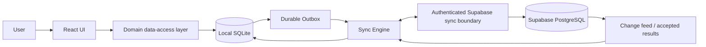

# Market Hub / Vortex ERP — Offline-First Architecture Study

**Status:** Study / Architecture Plan only — no implementation performed  
**Repository:** `mosaa65/market-hub`  
**Baseline:** `main` at `6598793` (inspected 2026-09-29)  
**Scope:** Windows single-device installation, full operational offline use, later bidirectional synchronization with Supabase.  
**Branch:** `yunis-offline-architecture`

> This document is an architectural study, not an implementation. Existing source, SQL, migrations, configuration, dependencies, and UI were not changed.

## Executive Summary

Market Hub is a browser-hosted Vite/TanStack React ERP whose operational truth is Supabase PostgreSQL. The repository contains POS and sales, purchases and returns, catalog, warehouses, inventory, transfers, batches, customers, suppliers, payments, debts, statements, finance, reports, audit, users, permissions, platform modules, printing, backup helpers, and notifications. The database already uses relational foreign keys, RLS, triggers, RPCs for business transactions, and Supabase Auth.

A cache-only or PWA-only approach cannot safely support the requested offline ERP scope. The recommended target is a **Windows desktop shell (Tauri preferred) containing the existing React UI, a local encrypted SQLite database, a local transaction/data-access layer, and a durable operation-based outbox/inbox sync engine connected to a server-side Supabase sync API/RPC boundary**. Supabase remains the cloud system of record for shared/cloud state; local is the operational replica and transaction boundary while offline. The first release should explicitly support one device per business and one writer, which sharply reduces conflicts. The design must preserve immutable sales, purchases, stock movements, payments, and audit events rather than applying generic Last Write Wins.

The key product constraint is: **offline entry and local consistency can be guaranteed; global inventory/financial consistency cannot be guaranteed while disconnected from another writer**. On reconnect, stock and financial business conflicts must be rejected, quarantined, reconciled, or compensated—never silently overwritten.

## Current Architecture Audit

### Technology and runtime

- Vite SPA (`dev`, `build`, `preview` scripts), React 19, TanStack Router/Start, TanStack React Query, TypeScript, Tailwind 4, Radix/shadcn-style UI.
- Supabase JS (`@supabase/supabase-js`) is the backend client.
- Direct platform boundaries include `src/integrations/supabase/client.ts`, `client.server.ts`, `auth-attacher.ts`, and `auth-middleware.ts`.
- No local database, durable outbox, sync cursor, inbox, conflict store, or offline authentication layer was found in the inspected tree.
- Browser persistence is not a substitute for the relational transaction model required by this ERP.

### UI and modules observed

Routes include dashboard, analytics, POS, purchase POS, sales, purchases, sales returns, purchase returns, products/catalog, inventory, transfers, warehouses, batches, customers, suppliers, payments, settlements, debts, account statements, finance, daily journal, trial balance, income statement, balance sheet, reports, notifications, audit, users, settings, plans/platform admin, loyalty, barcodes, and Vortex UI.

Relevant areas are split between `src/routes`, `src/components`, `src/hooks`, `src/lib`, and `src/integrations`. This is a reasonable UI starting point, but route components need a future repository-independent domain/data boundary so they do not decide whether a query is local or remote.

### Database and server behavior observed

The repository contains **47 SQL migration files**. The migration history includes profiles, user roles, company settings, warehouses, categories, brands, units, products, inventory, stock movements, customers, suppliers, sales and purchase invoices/items, sales and purchase returns/items, stock transfers, expenses, customer ledger, payments/collections, debts, statements, batches, platform/subscription tables, RLS policies, updated-at triggers, user/profile/role functions, and transaction RPCs including `create_sale`, `create_purchase`, invoice numbering functions, and ledger posting/repair functions.

Existing RPCs are likely the current atomic business boundary. Offline code cannot call them while disconnected; an offline transaction model must reproduce their invariants locally and submit an equivalent immutable command to a trusted server boundary on reconnect. Exact RPC signatures and every table constraint must be mapped before implementation.

### Direct Internet/Supabase coupling to isolate

1. Supabase client construction and auth/session listeners.
2. TanStack Query functions calling `.from(...)`, `.rpc(...)`, or Supabase auth.
3. Mutations that write invoice headers/items, stock, payments, expenses, returns, transfers, ledgers, and settings.
4. Server-generated invoice numbers, timestamps, triggers, and database-derived balances.
5. RLS-dependent reads/writes and role checks.
6. Report queries aggregating cloud tables directly.
7. Notifications/platform/subscription flows that depend on cloud state.
8. Backup and export helpers that assume browser/cloud availability.

A complete implementation audit must inventory every `.from`, `.select`, `.insert`, `.update`, `.upsert`, `.delete`, `.rpc`, `auth.*`, and `functions.invoke` caller and map it to a domain command/query.

## Requirements and Invariants

- Windows installable app; one device per customer in release one.
- All supported operational modules usable without Internet for an unlimited period, subject to local disk, licensing policy, and preloaded reference data.
- Local transactions atomic and recoverable after crash/power loss.
- No service-role key in the client.
- Every operation has globally unique operation ID/idempotency key and device ID.
- Financial and inventory events are append-only/immutable after posting; corrections are compensating transactions.
- Sync is at-least-once transport with idempotent server application, not network exactly-once.
- Deletions use tombstones and retention rules.
- Audit records actor, device, operation, time, before/after or event details, and sync outcome.
- Cloud authorization remains server-side; local permissions are a cached authorization snapshot with explicit device-compromise limitations.

## Offline Capability by Module

| Module | Offline capability | Local data / operations | Online-only or risk | Sync policy |
|---|---|---|---|---|
| Products, categories, brands, units | Yes | Replica, local CRUD with UUIDs | Cross-device edits; uniqueness | Versioned data conflict/review |
| Warehouses | Yes for one device | Replica and transfers | Concurrent stock | Versioned master data; stock commands |
| Inventory | Yes locally | Ledger projections and movements | Global availability while disconnected | Server validation; quarantine |
| Adjustments/transfers | Yes with local rules | Atomic command + movements | Concurrent warehouse balance | Reject/reconcile, never LWW |
| Purchases/returns | Yes | Draft/post invoice, supplier ledger, stock effects | Duplicate supplier document | Idempotent immutable command |
| Sales/returns/POS | Yes | Atomic sale, receipt, customer effect | Global oversell | Server validate on reconnect |
| Customers/suppliers | Yes | Cached and created/edited locally | Duplicate identity/merge | UUID + uniqueness review |
| Payments/collections | Yes locally | Immutable payment and ledger event | External settlement confirmation | Reconcile server-side |
| Receivables/payables | Yes as local projection | Derived from posted events | Concurrent postings | Rebuild/reconcile |
| Expenses/finance | Yes locally | Journal/event and reports | Period controls | Append-only validation |
| Reports/dashboards | Yes for replicated scope | Local SQL projections | Cloud-only metrics | Show freshness/scope |
| Batches/expiry | Yes if preloaded | Batch quantities and expiry checks | Concurrent allocations | Stock conflict policy |
| Settings | Mostly yes | Device/business snapshot | Subscription/platform settings | Ownership by field |
| Users/permissions | Limited yes | Cached users/roles | Revocation/new users | Signed snapshot; online recheck |
| Audit logs | Yes append-only | Local events and sync status | Cloud tamper evidence | Append-only upload |
| Notifications/subscriptions | Partial | Local operational alerts | Push, billing, external delivery | Queue/skip offline |
| Platform admin | No/limited | Cached read-only view | Multi-tenant/billing operations | Online-only boundary |
| Printing/barcodes/PDF | Yes | Local templates/assets/printer | Uncached cloud assets | Package templates |

## Architecture Options and Decisions

### A — Cache only
Useful for read acceleration and short outages. It cannot atomically persist a new invoice plus stock movement plus ledger, guarantee durable queues, or rebuild reports. **Reject as primary; retain as a sub-mechanism.**

### B — PWA + IndexedDB/Dexie
Installable and low friction, but relational constraints, financial transactions, backups, encryption, large reports, and file/printing integration are weaker. Suitable for a lightweight POS, not this full ERP without building a large database layer around it.

### C — Local-first architecture
The correct behavioral model: local reads/writes first, sync later. It is not a database product itself; pair it with a durable relational store and command protocol. **Adopt as the principle.**

### D — Embedded SQLite
Strong fit for one Windows device: transactions, foreign keys, constraints, mature backup, small footprint, fast local reports, and easy bundling. Requires schema parity/mapping with PostgreSQL and a trusted sync boundary. **Recommended local database.**

### E — PGlite/embedded PostgreSQL-compatible database
May reduce SQL translation, but WASM/runtime, file durability, Windows packaging, encryption, migrations, memory, and native integration add uncertainty. Keep as proof-of-concept alternative only.

### F — Local PostgreSQL server
Excellent SQL compatibility, but installer/service lifecycle, ports, upgrades, resource use, security, backup, and support are disproportionate for one device. **Reject v1.**

### G — Local application server + browser + local DB
Good isolation and UI reuse, but adds localhost service, port/security lifecycle, installer complexity, and another API boundary. Viable alternative.

### H — Tauri
Preferred shell: small native footprint, OS integration, native database/crypto options, and better source exposure than a raw browser deployment. Web assets remain inspectable; it is not source secrecy. Requires Rust/native expertise and signed updater discipline.

### I — Electron
Mature and easy Node integration, but larger footprint and broader attack surface. Fallback when libraries/team skills favor Node.

### J/K — Desktop + local DB + Supabase/cloud replica + sync
Recommended system shape. Supabase remains cloud authority for shared state; local is offline operational replica and pending-command journal.

### L — Operation-based Outbox/Inbox
Required for durable, retryable, idempotent, auditable bidirectional sync. Row snapshots alone cannot safely represent sales, payments, and stock effects. **Adopt.**

## Comparison Matrix

| Criterion | Cache/PWA | IndexedDB | SQLite desktop | Local PostgreSQL | Tauri + SQLite + sync |
|---|---:|---:|---:|---:|---:|
| Full ERP offline | Low | Medium-low | High | High | High |
| Transactions/integrity | Low | Medium | High | Very high | High |
| Windows install | High/medium | High | High | Low | High |
| SQL/reporting | Low | Low-medium | High | Very high | High |
| Backup/recovery | Low | Medium | High | High but operational | High |
| Encryption | Limited | Limited | Good | Good | Good |
| Sync complexity | High | High | High but controllable | High | High |
| Supabase/Postgres compatibility | Direct reads only | Mapping required | Mapping required | Highest | SQLite mapping + API |
| RLS/Auth compatibility | Online only | Boundary required | Boundary required | Direct-ish | Server boundary required |
| Performance for ERP reports | Low-medium | Medium | High | High | High |
| Maintenance/deployment | Low initially, high later | Medium | Medium | High | Medium-high |
| Source protection | Low | Low | Medium | Medium | Medium |
| Future multi-device | Weak | Medium | High with sync design | High | High |
| Recommendation | Reject primary | Reject primary | Choose store | Reject v1 | Choose package |

## Local Database Decision

Choose **SQLite** with foreign keys enabled, WAL mode where appropriate, explicit migrations, parameterized queries, integer minor units/decimal-safe monetary representation, and a native/managed encryption strategy suitable for the threat model. Do not mirror every PostgreSQL implementation detail blindly: keep cloud IDs as UUID/text, preserve server timestamps and versions, add local sync metadata, and model immutable business events explicitly.

Future metadata tables (not created here): `device`, `sync_state`, `outbox_operations`, `inbox_operations`, `sync_conflicts`, `tombstones`, `local_migrations`, and `audit_events`. Business aggregates should carry `id`, `business_id`, `origin_device_id`, `created_at`, `updated_at`, `server_version`/`aggregate_version`, and deletion state as appropriate.

| Store | Strength | Blocking concern |
|---|---|---|
| SQLite | Durable relational transactions, constraints, backup, native Windows fit | PostgreSQL SQL/RPC behavior must be mapped |
| PGlite | PostgreSQL-like SQL | WASM durability/packaging and maturity risk |
| Local PostgreSQL | Highest SQL parity | Service installation/support overhead |
| IndexedDB/Dexie | Browser-native and easy PWA | Weak relational/financial/reporting foundation |

## Supabase Architecture and Data Flow

Use Supabase + local DB + sync engine. Supabase remains cloud authority for accepted shared state, tenant identity, accepted operation log, server versions, global uniqueness, subscription/platform state, and cloud audit. Local owns the device working set, local atomicity, offline projections, pending operations, printer/templates, and sync status.

RLS remains the cloud authorization layer. The desktop app uses publishable credentials only. Existing RPCs can remain authoritative online where their invariants are correct. A future authenticated sync/API boundary should accept typed commands, validate permissions and expected versions, apply idempotently, and return accepted/rejected/conflict results. Do not expose arbitrary table replication as the business protocol.

Online: user → UI → local DB → outbox → sync engine → Supabase. Offline: user → UI → local transaction → outbox. Reconnection submits pending commands, pulls changes by cursor, applies accepted results, and records rejections/conflicts.

Use operation IDs and idempotency keys generated before local commit. Transport is at-least-once. Server inbox deduplicates operation IDs and returns the original result. Use cursor/sequence rather than wall-clock `updated_at` alone. Tombstones remain until replicas have advanced beyond retention. Use exponential backoff with jitter, batching, bounded concurrency, and visible sync status.

## Sync Engine Design

Required concepts: UUID operation ID, idempotency key, device ID, local sequence, server sequence/cursor, aggregate version, `created_at`/`updated_at`, tombstones, change tracking, retry/backoff, partial sync, duplicate detection, crash-safe state transitions, and conflict records. Exactly-once network delivery is not realistic; achieve exactly-once business application through idempotent server processing. Outbox state must survive crashes and be replayable. Inbox acceptance and local result application need durable checkpoints.

## Conflict Resolution

Do not use global Last Write Wins.

| Conflict | Policy |
|---|---|
| Product/category/name/description | Field-level/version conflict or deterministic merge, then review |
| Customer/supplier profile | Version check; preserve both values or manual merge |
| Sales/purchases/returns/payments/expenses | Immutable command; idempotent apply; reject invalid/duplicate; never overwrite |
| Inventory movement | Validate server stock/period; quarantine if insufficient/concurrent |
| Settings | Field ownership; server-owned subscription/security settings win |
| Audit | Append-only; no update/delete merge |
| Derived balances/reports | Rebuild from accepted events; do not sync mutable totals |

A data conflict (product name) can be merged. A business conflict (two offline sales consume the same stock) needs server validation, a conflict record, operator review, or compensating transaction. It must never silently lose either operation.

## OFFLINE INVENTORY CONSISTENCY

At local commit validate product, warehouse, batch, expiry, unit conversion, negative-stock policy, and local quantity in one SQLite transaction. Record immutable stock movement linked to the document; derive inventory projections from movements. Sales decrement, purchases increment, returns reverse direction, transfers create paired out/in movements, and adjustments require reason and actor.

Offline availability is only local reservation truth. On reconnect, submit document command and expected inventory versions/quantities; server atomically validates all affected warehouses/batches and applies or rejects the complete command. On rejection retain the original document/movement, mark `conflict`, show the reason, and offer controlled void/compensation, adjustment, or manager reconciliation. Never delete movement, mutate history, or overwrite it with a cloud snapshot.

## Financial Integrity

Payments, collections, expenses, receivables, payables, balances, and return effects should be append-only journal events with stable UUIDs and source references. Local posting atomically creates document, financial event(s), and audit event. Derived balances are rebuildable projections.

Offline operations can be recorded and printed but cannot guarantee external settlement, tax acceptance, or global duplicate detection until reconnect. Server checks idempotency, device/actor authorization, accounting period, currency/rounding, and document state. Human-readable numbers may be device-scoped or server-confirmed; UUIDs provide identity. Conflicts are rejected/quarantined and resolved by reversal/compensation, never by editing posted history.

## Authentication, Permissions, and Licensing Offline

Supabase Auth is online for initial identity/session operations. Perform online enrollment and receive a device-bound, signed offline authorization package containing business ID, user ID, role/permission snapshot, device ID, issuance metadata, and key identifiers. Store refresh/session material in Windows credential storage where possible. Offline login unlocks only enrolled device/user; revocation cannot take effect until reconnect.

Never put service-role key or signing secret in client. Server signs packages and re-authorizes every sync command. For unlimited offline use, use a signed perpetual/offline license or locally verifiable entitlement with optional—not mandatory—revalidation. Device binding reduces casual copying but cannot defeat an administrator controlling the machine.

## Windows Packaging and Source Protection

**Recommended:** Tauri desktop shell + React assets + native SQLite access + signed installer/update artifacts. Keep DB under per-user/per-machine application data, not installation directory. Store backups separately; rotate logs. Run migrations before opening a new version, with backup and rollback guards.

Electron is a valid fallback at cost of memory/size. PWA is secondary access, not full ERP target. A local server is viable but has service lifecycle and HTTP security costs. Require code signing, explicit data-preservation uninstall policy, signed update metadata, migration compatibility, offline update packages, printer/PDF support, and crash recovery.

A client-owned machine is untrusted. Bundling, minification, obfuscation, and native components raise effort but do not prevent extraction. Encryption protects stolen files when keys are protected, not a running app from local administrator. Use secure storage, signed releases, integrity checks, server reconciliation, operation UUIDs, replay protection, and rate limits; do not claim perfect DRM.

## Initial Sync and Migration

1. Online enrollment creates/chooses business and device identity.
2. Snapshot cloud data in dependency order: business/settings, users/roles, warehouses, units/categories/brands/products, batches, customers/suppliers, opening inventory, invoices/returns, movements, journal/payment events, audit metadata.
3. Preserve UUIDs and foreign keys; never match by names. Record snapshot sequence and per-table/aggregate versions.
4. Import into staging, validate counts, keys, totals, currencies, and inventory projections.
5. Atomically promote validated snapshot, initialize cursor/outbox/inbox, and run reconciliation.
6. Resume incremental pull and local commands. Checkpoints and stable IDs make retries non-duplicating.

Treat historical data as accepted baseline. New local operations receive new UUIDs and origin metadata; never invent cloud acceptance timestamps/versions.

## Backup, Recovery, and Performance

Use automatic rotating local snapshots while idle and before migration, SQLite online backup semantics, manual encrypted export, optional cloud export, restore-to-separate-location verification, WAL/checkpoint policy, and forensic preservation on corruption. Sync crash recovery replays idempotent pending operations. Migration is versioned and transactional with pre-migration backup.

Benchmark actual largest catalog/history and reports. Use indexes, pagination, projections, and cursor batches. Measure startup, sale commit latency, report latency, memory, disk growth, initial/incremental sync throughput, and months-offline backlog. Do not promise numeric limits without production data.

## Exact Future-Affected Files and Supabase Areas

### Must change

- `src/integrations/supabase/client.ts`, `client.server.ts`, `auth-attacher.ts`, `auth-middleware.ts` to isolate online/enrollment/sync boundaries.
- `src/routes/_app.tsx` and data-bearing routes to depend on domain query/command interfaces.
- Direct Supabase data access spread across `src/routes`, `src/components`, `src/hooks`, and `src/lib`.
- New future modules such as `src/domain`, `src/data/local`, `src/data/cloud`, `src/sync`, `src/auth/offline`, `src/licensing`.
- Native/Tauri shell and installer/update configuration.

### Probably change

- `src/lib/backup/*` for transactional DB backup/export.
- Statement, report, and finance libraries for local projections and freshness status.
- POS, purchases, returns, inventory, transfers, payments, and audit components for atomic commands and sync status.
- TanStack Query setup for local commit and sync invalidation.

### May change

Printing/PDF/barcode assets, notifications, settings, platform/admin routes, and deployment scripts depending on scope.

### Should not change without invariant review

Existing business semantics, accounting rules, RLS intent, posted history, and migration history. Existing RPCs should be reused or superseded only with equivalence tests.

### Supabase likely required later

Sync protocol/inbox/outbox or accepted-command tables, server cursor/change sequence, tombstones, conflicts, device enrollment, signed offline authorization, immutable operation/audit metadata, idempotent RPCs, expected-version checks, device/business RLS, and possibly an Edge Function/API layer. Do not ship service-role credentials.

## Implementation Roadmap (future)

1. Contract/call-site/table/RPC/RLS audit and invariant catalog.
2. Typed domain command/query boundary with online adapter.
3. SQLite schema, migrations, projections, encryption, backup/restore; prove atomic sale/purchase/payment.
4. Device enrollment, signed permission snapshot, secure offline login.
5. Offline catalog/parties, POS, purchases/returns, inventory/transfers/batches, finance/payments, reports.
6. Durable outbox/inbox, IDs, retries, cursor, tombstones, observability.
7. Authenticated server command boundary, validation, conflicts, reconciliation, RLS, audit.
8. Tauri installer, signing, updates, data locations, migrations, printer/backup behavior.
9. Perpetual license/device enrollment and security review.
10. Fault-injection, long-offline pilot, restore drills, staged production rollout.

## Testing Strategy

Test online/offline every module; disconnect during each commit; kill process/cut power during transaction, backup, migration, and sync; replay duplicates; partial responses; network flapping; days/months offline; cloud-side edits; stock, batch, return, payment, receivable, payable, and financial conflicts; tombstones; large catalog/history/outbox; corruption/restore; expired sessions/offline login; permission changes; cloned IDs; signed update failure; printer/PDF; and multi-device simulation.

Acceptance gates: no duplicate stock/financial event, no silently lost operation, rejected commands remain visible, accepted commands replay safely, local totals reconcile to event history, server totals reconcile after sync, and restore yields a known consistent state.

## Open Questions

- Tenant/business ownership and whether one installation serves multiple businesses.
- Mandatory offline modules for first release versus online-only platform administration.
- Negative stock, accounting period closing, tax/fiscal requirements, and document numbering.
- Full history versus configurable working set.
- Legal licensing expectations and acceptable copying risk.
- Supported Windows versions, printer/scanner hardware, and update channel.
- Whether every existing RPC is authoritative for every posting path.
- Conflict operator workflow and compensation authority.
- Cloud retention window for tombstones and operation history.

# FINAL ARCHITECTURE DECISION

### Recommended Architecture
Tauri + existing React/TanStack UI behind a domain data-access layer + encrypted SQLite local replica + local atomic transaction service + operation-based outbox/inbox + authenticated Supabase sync/command boundary.

### Why
It is the smallest architecture that provides durable full-ERP offline transactions, local reports, Windows installation, crash recovery, and controlled future synchronization without operating local PostgreSQL.

### Why Not Cache Only
Cache cannot represent durable atomic invoice, stock, payment, ledger, audit, and report state.

### Why Not Local Database Only
It creates divergent data without authoritative reconciliation, enrollment, or duplicate handling.

### Why Supabase Should / Should Not Remain
Keep Supabase for cloud authority, shared state, RLS, online Auth, server validation, backups, and sync. Do not make offline behavior depend on direct calls or privileged keys.

### Recommended Local Database
SQLite with foreign keys, explicit migrations, encrypted storage, durable sync metadata, and event/projection modeling.

### Recommended Windows Packaging
Tauri with signed installer and updates; Electron is fallback for Node constraints.

### Recommended Sync Strategy
At-least-once delivery, idempotent server inbox, durable outbox, cursor pull, tombstones, retry/backoff, and visible reconciliation.

### Recommended Conflict Strategy
Merge low-risk master data; server-validate and quarantine business conflicts; use immutable events and compensation; never global LWW for stock or finance.

### Recommended Authentication Strategy
Online enrollment plus device-bound signed offline authorization and local role snapshot; re-authorize every sync command server-side.

### Recommended Licensing Strategy
Signed perpetual/offline license with device enrollment and optional revalidation; accept administrator-level tampering risk.

### Biggest Risks
Reproducing RPC/RLS/accounting invariants locally, inventory conflicts, hidden direct Supabase dependencies, secure offline authorization, migration correctness, and damaged-device support.

### What Must Be Tested Before Production
Atomic local posting, crash/power recovery, duplicate/replay safety, stock/financial conflicts, restore/migration, long offline periods, permission/license compromise, sync interruption, and reconciliation against Supabase.

### Estimated Implementation Complexity
High. The first implementation should be a vertical slice: enrollment → offline sale → local stock/ledger → reconnect → idempotent acceptance/rejection → reconciliation, before migrating every module.

## Conclusion

The project is a strong candidate for offline-first evolution because it already has a relational ERP model and explicit server-side business functions. The safe path is not to make browser cache smarter; it is to introduce a local transactional system and command-oriented synchronization contract, then migrate modules incrementally with accounting and inventory invariants as acceptance gates. This study stops before implementation, database changes, Supabase changes, dependency changes, or production configuration changes.

## Appendix: Inspection Evidence

- Repository baseline: commit `6598793` on `main`.
- Build/runtime: Vite scripts, React 19, TanStack Router/Start, TanStack React Query.
- Supabase dependency: `@supabase/supabase-js`.
- SQL migrations inspected: 47 files under `supabase/migrations`.
- Supabase integration files inspected: `src/integrations/supabase/*`.
- Route/module inventory inspected under `src/routes` and supporting `src/components`, `src/hooks`, and `src/lib`.
- No implementation files were modified by this study.
