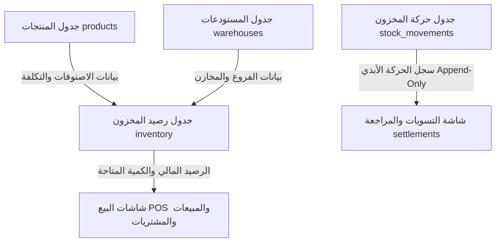

# تقرير التحليل الشامل لنظام التسوية والمخزون — فورتيكس ERP

> **تاريخ التحليل:** 2026-09-29  
> **إعداد:** مهندس النظام / Antigravity AI  
> **الحالة:** مرحلة التحليل فقط (لم يتم إجراء أي تعديل على قاعدة البيانات أو الكود حتى الآن)  

---

## 1. المقدمة والالتزام بشرط حماية البيانات

تم إجراء هذا التحليل بفحص الكود المصدري الفعلي لمشروع **Market Hub (Vortex ERP)** وجداول قاعدة البيانات (Supabase PostgreSQL) والـ RPC Functions وتراكيب الصفحة ذات العلاقة.

### ⚠️ التزام صارم بضوابط حماية البيانات:
- **لم يتم إجراء أي تعديلات** على الكود المصدري.
- **لم يتم إنشاء أي migrations** أو تعديل Schema قاعدة البيانات.
- **لم يتم حذف، تعديل، أو إضافة أي بيانات** في قاعدة البيانات الحالية.
- **لم يتم إجراء أي عملية Truncate أو Seed** على البيئة الحية.
- **جميع التعديلات المستقبلية** ستكون محصورة داخل الفرع المستقل `yunis-fix-adjustment` بعد الموافقة الصريحة.

---

## 2. فهم النظام الحالي وطريقة عمل المخزون

تتكون البنية التحتية لإدارة المخزون في النظام الحركي من 3 ركائز أساسية:

### أ. جدول رصيد المخزون الحالي (`public.inventory`)
- **الأعمدة:** `(id, product_id, warehouse_id, quantity, updated_at)`
- **القيود:** `UNIQUE (product_id, warehouse_id)`
- **الوظيفة:** يمثل الرصيد اللحظي الحالي لكل صنف داخل مستودع محدد. يعتمد عليه كاشير نقاط البيع (POS) وشاشات المبيعات لمعرفة الكمية المتاحة للبيع.

### ب. سجل حركات المخزون (`public.stock_movements`)
- **الأعمدة:** `(id, product_id, warehouse_id, movement_type, quantity, unit_cost, reference, note, adjustment_reason, created_by, created_at, reference_type, reference_id)`
- **أنواع الحركات المسجلة (`movement_type`):**
  - `purchase`: مشتريات (+ كمية)
  - `sale`: مبيعات (- كمية)
  - `adjustment`: تسوية مخزنية (+ / -)
  - `transfer_in` / `transfer_out`: تحويل بين مستودعين (+ / -)
  - `return_in` / `return_out`: مرتجعات مبيعات ومشتريات (+ / -)
  - `opening`: رصيد افتتاحي (+ كمية)
- **الوظيفة:** سجل تدقيق أمني ومحاسبي غير قابل للحذف أو التعديل (Append-Only Audit Ledger) يسجل تفاصيل كل حركة تؤثر على المخزون.

### ج. جدول المنتجات (`public.products`)
- يحتوي على بيانات الصنف العامة (الاسم، SKU، الباركود، سعر التكلفة `cost_price`، سعر البيع `sale_price`...).
- **ملاحظة محورية:** جدول المنتجات **لا يحتوي** على عمود كمية مستقل؛ فالكمية تُقرأ دائمًا من جدول `inventory` المربوط بالمستودعات.

---

## 3. الإجابة على الأسئلة التحليلية التفصيلية

### س1: من أين تأتي كمية المخزون الحالية؟
تأتي من جدول `inventory` المربوط بـ `products` و `warehouses`. 
- عند التصفية بمستودع محدد: تُقرأ الكمية مباشرة من `inventory.quantity` بشرط `warehouse_id = selected_warehouse`.
- عند اختيار "جميع المستودعات": يتم جمع كميات المنتج عبر جميع المستودعات المسجلة باستخدام دالة تجميعية `reduce((a, i) => a + Number(i.quantity), 0)`.

### س2: أين يتم تعديل كمية المخزون في الكود الحالي؟
تُعدل الكمية في الأماكن التالية:
1. **دالة المبيعات (`create_sale` RPC)**: تخفض رصيد `inventory` وتدرج حركة `sale` في `stock_movements`.
2. **دالة المشتريات (`create_purchase` RPC)**: تزيد رصيد `inventory` وتدرج حركة `purchase` في `stock_movements`.
3. **دالة التحويلات (`create_stock_transfer` RPC)**: تخفض من المستودع المصدر وتزيد في المستودع الهدف وتدرج حركتي `transfer_out` و `transfer_in`.
4. **دالة مرتجعات المبيعات (`create_sales_return` RPC)**: تزيد رصيد `inventory` وتدرج حركة `return_in`.
5. **دالة مرتجعات المشتريات (`create_purchase_return` RPC)**: تخفض رصيد `inventory` وتدرج حركة `return_out`.
6. **نافذة تعديل المخزون اليدوية (`AdjustDialog` في `_app.inventory.tsx`)**: تقوم بعمل `upsert` لجدول `inventory` وإدخال حركة `adjustment` في `stock_movements`.

### س3: هل يوجد أكثر من منطق لحساب المخزون؟
- **المنطق الأساسي متسق**: تجميع وإجابات الرصيد تعتمد على `inventory.quantity`.
- **الاختلاف في واجهة العرض**:
  - صفحة المخزون `_app.inventory.tsx` تعرض المجموع الكلي لجميع المستودعات إذا لم يحدد المستخدم مستودعاً.
  - صفحة الـ POS تعتمد على مستودع الكاشير المحدد وتمنع التعامل مع رصيد عام غير محدد بمستودع.

### س4: كيف تعمل صفحة التسوية حالياً؟
- **الموقف الحالي لصفحة التسويات `src/routes/_app.settlements.tsx`**:
  - **ماذا تعرض؟** تعرض سجلاً تاريخياً (Read-only Log) لكل حركات `stock_movements` (مبيعات، مشتريات، تسويات، تحويلات...).
  - **المشكلة الجوهرية**: **الصفحة لا تحتوي على أي زر أو نموذج لتنفيذ تسوية جردية جديدة!**
  - **أين تقع عملية التسوية حالياً؟** تقع بشكل مصغر ومستقل داخل صفحة المخزون `_app.inventory.tsx` عبر نافذة `AdjustDialog`.

### س5: كيف تتعامل الصفحات الأخرى مع المخزون؟
جميع الصفحات الأخرى (POS، المبيعات، المشتريات، التحويلات، المرتجعات) تعمل عبر **قواعد بيانات ذرية (Atomic Database RPC Functions)** تضمن تحديث جدول `inventory` وإصدار سجل حركة في `stock_movements` بنفس التوقيت وبشكل آمن ومحمي.

### س6: هل هناك تعارض؟
نعم، هناك تعارض في طريقة تجربة المستخدم والمنطق:
1. المستخدم يذهب لصفحة "التسويات" ويتوقع إمكانية إجراء تسوية، لكنه يجدها صفحة للعرض فقط.
2. نافذة التعديل الحالية في صفحة "المخزون" تطلب إدخال "الكمية المضافة أو المخصومة (Delta)"، بدلاً من إدخال **"الجرد الفعلي"**، مما يجبر المستخدم على حساب الفرق يدوياً خارج النظام قبل الإدخال.

### س7: هل التسوية مرتبطة بالمستودع بشكل صحيح؟
نعم، البيانات خاضعة لمفهوم المستودعات (`warehouse_id`)، ولكن النافذة الحالية تتطلب اختيار المستودع من أعلى صفحة المخزون أولاً قبل الضغط على زر التعديل، وإذا كان التصفية على "جميع المستودعات" يتم تعطيل زر التعديل.

### س8: هل هناك تأثير مالي؟
- عند تسجيل حركة تسوية، يتم تخزين `unit_cost` (تكلفة الوحدة للتسوية) في جدول `stock_movements` بناءً على سعر تكلفة الصنف `products.cost_price`.
- التقرير المالي وقائمة المركز المالي يحسبان إجمالي قيمة المخزون الحالية بضرب `inventory.quantity * products.cost_price`.
- التسوية بالزيادة تزيد القيمة المالية للمخزون، والعجز يخفضها.

---

## 4. المشكلة الفعلية والسبب التقني الحقيقي (Root Cause)

### المشكلة الفعلية:
1. **غياب مفهوم الجرد الفعلي المباشر**: النموذج الحالي يطلب من المستخدم اختيار (إضافة / خصم) وكتابة (مقدار التغير)، بدلاً من كتابة (الجرد الفعلي الموجود على الرف) وترك النظام يحسب الفرق.
2. **فصل واجهة التسوية عن صفحة التسويات**: صفحة `_app.settlements.tsx` مخصصة للعرض فقط، ولا توجد بها إمكانية إنشاء عملية تسوية جردية معتمدة.
3. **غياب التثبت من الحالة المطابقة**: إذا قام المستخدم بجرد وكان الرصيد الفعلي يطابق رصيد النظام (مثال: 100 = 100)، المنظومة الحالية تستمر في فتح إمكانية الحفظ وإحداث حركة صفريّة أو غير ضرورية.

### السبب التقني الحقيقي:
- المكون `AdjustDialog` تم تصميمه سابقاً كـ Quick Patch سريع لإضافة أو خصم كميات يدوية من صفحة المخزون، ولم يتم بناء واجهة تسوية جردية معيارية (Standard Stock Adjustment Workflow) تقوم بـ:
  $$\text{الفرق} = \text{الجرد الفعلي} - \text{رصيد النظام}$$
  وتحديد نوع الفرق آلياً (`عجز` / `فائض` / `مطابق`).

---

## 5. الملفات ذات العلاقة بالمعالجة

| نوع الملف | مسار الملف | الدور والملاحظات |
| :--- | :--- | :--- |
| **Route / Component** | [src/routes/_app.settlements.tsx](file:///c:/Users/ahmed/Desktop/market-hub/src/routes/_app.settlements.tsx) | صفحة التسويات - إضافة زر "إجراء تسوية جردية جديدة" وربطه بنموذج التسوية الجردية المعياري |
| **Route / Component** | [src/routes/_app.inventory.tsx](file:///c:/Users/ahmed/Desktop/market-hub/src/routes/_app.inventory.tsx) | صفحة المخزون - تحديث نافذة التعديل لتستخدم نموذج التسوية المعياري الموحد |
| **Shared Component** | `src/components/stock/stock-adjustment-dialog.tsx` (جديد) | مكون موحد ومستقل لإجراء التسوية وفق الجرد الفعلي |
| **Translation** | [src/lib/i18n.tsx](file:///c:/Users/ahmed/Desktop/market-hub/src/lib/i18n.tsx) | إضافة مفاتيح الترجمة الخاصة بمفاهيم الجرد الفعلي، رصيد النظام، العجز، الفائض، المطابق |
| **Query Keys** | [src/lib/query-keys.ts](file:///c:/Users/ahmed/Desktop/market-hub/src/lib/query-keys.ts) | ضمان تحديث استعلامات `inventory` و `settlements` فور اعتماد أي تسوية |

---

## 6. قائمة المشاكل الواجب إصلاحها

1. **إضافة خيار تنفيذ التسوية في صفحة التسويات (`_app.settlements.tsx`)**:
   - إتاحة زر "تسوية جردية جديدة" يفتح نموذج الجرد والتسوية المباشر.
2. **تحديث نموذج التسوية ليعتمد على الجرد الفعلي**:
   - اختيار المستودع الصادر عنه الجرد.
   - اختيار المنتج.
   - يعرض النظام **رصيد النظام الحالي** للمنتج في هذا المستودع تلقائياً.
   - يدخل المستخدم **الجرد الفعلي** (الكمية الحقيقية).
   - يحسب النظام تلقائياً **الفرق** ونوعه:
     - إذا كان الفرق = 0 $\rightarrow$ الحالة **مطابق** (يتم منع حفظ تسوية بلا فارق).
     - إذا كان الجرد الفعلي < رصيد النظام $\rightarrow$ نوع الحركة **عجز (Shortage)** برقم سالب (مثال: -4).
     - إذا كان الجرد الفعلي > رصيد النظام $\rightarrow$ نوع الحركة **فائض (Surplus)** برقم موجب (مثال: +5).
3. **إلزامية السبب والتكلفة المرجعية**:
   - اختيار سبب التسوية (تلف، انتهاء صلاحية، عجز جرد، فائض جرد، آخر).
   - ترحيل سعر التكلفة المرجعي للصنف تلقائياً من `products.cost_price` مع إمكانية تعديله.
4. **تحديث المخزون وتوثيق الحركة**:
   - تعديل رصيد `inventory` ليصل تماماً إلى رقم **الجرد الفعلي**.
   - تسجيل حركة صريحة في `stock_movements` بنوع `adjustment` مع تسجيل الفرق والسبب والمستخدم والمستودع وتاريخ العملية.
5. **توحيد المكون**:
   - استخدام نفس المكون المعياري في كل من صفحة المخزون `_app.inventory.tsx` وصفحة التسويات `_app.settlements.tsx`.

---

## 7. خطة الإصلاح خطوة بخطوة (Fix Plan)

### الخطوة 1: إنشاء Branch العمل
- **الفرع**: `yunis-fix-adjustment` (انطلاقاً من الفرع الحالي).

### الخطوة 2: إنشاء المكون الموحد `StockAdjustmentDialog`
- **الملف**: `src/components/stock/stock-adjustment-dialog.tsx`
- **التغيير**:
  - استقبال `productId` و `warehouseId` (أو إتاحة اختيارها من داخل النافذة).
  - جلب رصيد النظام الحالي تلقائياً من جدول `inventory`.
  - حقل إدخال **الجرد الفعلي**.
  - معادلة لحظية: `diff = actualCount - systemQuantity`.
  - عرض بطاقة توضيحية ملونة (عجز باللون الأحمر، فائض باللون الأخضر، مطابق باللون الأزرق/الرمادي).
  - عند الاعتماد:
    1. تحديث `inventory` بالكمية الفعلية الجديدة.
    2. إدخال حركة `stock_movements` بفرق الكميات وحفظ `adjustment_reason` والتكلفة.
- **تأثيره على المخزون**: يضمن صحة رصيد المستودع وتطابقه التام مع الواقع دون حسابات يدوية خاطئة.
- **تأثيره على قاعدة البيانات**: **لا يحتاج أي تغيير في DB Schema أو Migrations** (الجداول والأعمدة الحالية متوافقة 100%).

### الخطوة 3: تحديث صفحة التسويات `_app.settlements.tsx`
- **الملف**: `src/routes/_app.settlements.tsx`
- **التغيير**:
  - إضافة زر رئيسي في أعلى الصفحة: `إجراء تسوية جردية جديدة`.
  - عند الضغط عليه، يفتح المكون `StockAdjustmentDialog`.
  - بعد الاعتماد، يتم تحديث جدول التسويات تلقائياً عبر React Query `queryClient.invalidateQueries`.
- **تأثيره على المخزون**: تمكين إجراء التسوية مباشرة من صفحة التسويات.
- **تأثيره على DB**: لا يوجد.

### الخطوة 4: تحديث زر التعديل في صفحة المخزون `_app.inventory.tsx`
- **الملف**: `src/routes/_app.inventory.tsx`
- **التغيير**:
  - استبدال النافذة القديمة `AdjustDialog` واستخدام المكون المعياري الموحد `StockAdjustmentDialog`.
- **تأثيره على المخزون**: توحيد تجربة الجرد والتسوية عبر كافة صفحات النظام.
- **تأثيره على DB**: لا يوجد.

### الخطوة 5: تحديث الترجمات `src/lib/i18n.tsx`
- **الملف**: `src/lib/i18n.tsx`
- **التغيير**: إضافة النصوص العربية والإنجليزية المفاهيمية (الجرد الفعلي، رصيد النظام، الفرق، مطابق، عجز، فائض).

---

## 8. حماية قاعدة البيانات وتأكيد سلامة البيانات الحالية

> [!CAUTION]
> **ضمانات صارمة لحماية البيانات:**
> 1. **عدم إجراء أي Database Migrations**: هياكل الجداول الحالية (`inventory` و `stock_movements` و `products`) مكتملة وتدعم المنطق المطلوب تماماً.
> 2. **عدم مسح أو تعديل السجلات التاريخية**: لن يُجرى أي `DELETE` أو `UPDATE` على حركات المخزون السابقة في `stock_movements`.
> 3. **تعديل ذرّي (Atomic Update)**: تحديث رصيد جدول `inventory` يكون مستهدفاً لـ `(product_id, warehouse_id)` المحددين فقط في عملية التسوية، دون مساس بأي منتجات أو مستودعات أخرى.
> 4. **لا توجد بيانات وهمية أو تجريبية**: لن يتم إضافة أي بيانات اختبار على قاعدة البيانات الحالية.

---

## 9. حالات الاختبار المخطط لها (Test Cases)

1. **اختبار حالة العجز (Shortage / Deficiency):**
   - رصيد النظام = 100، الجرد الفعلي = 96.
   - **النتيجة المتوقعة**: الفرق (-4)، يتحدث المخزون ليصبح 96، وتسجل حركة تسوية بقيمة -4 مع سبب العجز.
2. **اختبار حالة الفائض (Surplus):**
   - رصيد النظام = 100، الجرد الفعلي = 105.
   - **النتيجة المتوقعة**: الفرق (+5)، يتحدث المخزون ليصبح 105، وتسجل حركة تسوية بقيمة +5 مع سبب الفائض.
3. **اختبار الحالة المطابقة (Matching):**
   - رصيد النظام = 100، الجرد الفعلي = 100.
   - **النتيجة المتوقعة**: النتيجة "مطابق"، مع زر حفظ معطل وتنبيه بعدم وجود فرق يستدعي تسجيل حركة تسوية.
4. **اختبار تعدد المستودعات:**
   - التأكد من أن التسوية في المستودع (أ) لا تؤثر مطلقاً على رصيد نفس الصنف في المستودع (ب).
5. **اختبار التوافق مع العمليات الأخرى:**
   - التأكد من أن المبيعات والمشتريات والتحويلات تعكس أرقام المخزون الجديدة المحدثة بعد التسوية فوراً وبشكل دقيق.
6. **اختبار الصلاحيات:**
   - التأكد من اقتصار إمكانية إجراء التسوية على أصحاب الصلاحيات المصرح لهم فقط (`owner`, `manager`, `warehouse`, `accountant`).

---

## 10. المخاطر والاحتياطات

- **الحساسية المخزنية**: تحديث `inventory.quantity` يؤثر مباشرة على الكمية المتاحة للبيع في شاشة الـ POS. ولذلك سيتم إخضاع عملية الاعتماد للتأكد الصارم من عدم قبول كميات سالبة أو مدخلات غير منطقية.
- **التوافق التام**: عدم التعديل في أسماء الأعمدة أو أنواع Enum يضمن سلامة واستقرار النظام كلياً وعدم تأثيره على باقي الخدمات.

---

*هذا التقرير محفوظ كمستند مرجعي مستمر في ملف Markdown.*
