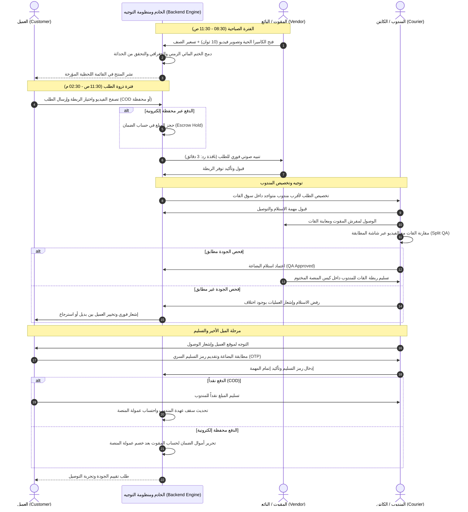
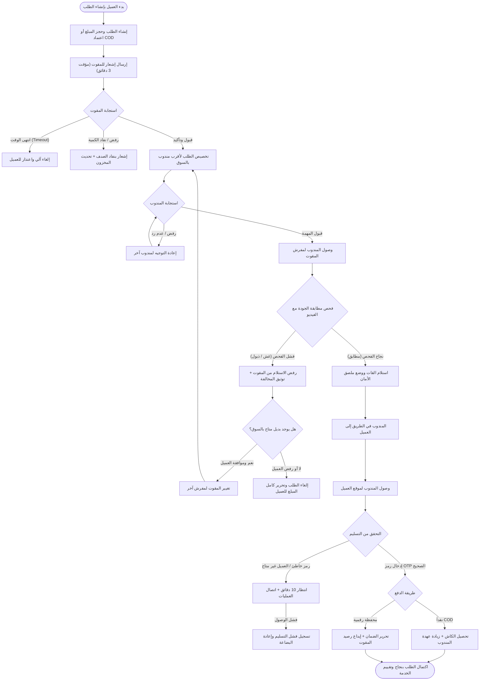
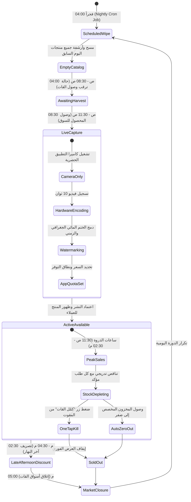

# وثيقة المواصفات الفنية والتشغيلية وهندسة النظم (PRD & System Architecture)
## منصة بيع وتوصيل القات السريع في اليمن (Quick-Commerce Qat Logistics Platform)

---

### جدول المحتويات
1. [المقدمة والرؤية المعمارية للمنظومة](#1-المقدمة-والرؤية-المعمارية-للمنظومة)
2. [القسم الأول: التحليل التشغيلي وخيارات المقايضة (Trade-off Analysis)](#2-القسم-الأول-التحليل-التشغيلي-وخيارات-المقايضة-trade-off-analysis)
   - 2.1 التسجيل والتحقق والاعتماد (Onboarding & KYC)
   - 2.2 دورة حياة المنتج والوسائط اليومية (Daily Inventory & Media Lifecycle)
   - 2.3 إدارة التوفر والمخزون المزدوج (Dual Availability Management)
   - 2.4 آلية الطلب والاعتماد وضبط الجودة (Ordering, SLAs & QA Inspection)
   - 2.5 المنظومة المالية والتسويات (Fintech, Escrow & Settlements)
   - 2.6 فض النزاعات وحماية السمعة (Dispute Resolution & System Resilience)
3. [القسم الثاني: المخططات الهندسية والتفاعلية (Mermaid Architecture Diagrams)](#3-القسم-الثاني-المخططات-الهندسية-والتفاعلية-mermaid-architecture-diagrams)
   - 3.1 مخطط رحلة الطلب الشاملة (End-to-End Sequence Diagram)
   - 3.2 آلة حالات الطلب (Order State Machine Flowchart)
   - 3.3 دورة حياة المنتج على مدار 24 ساعة (24-Hour Lifecycle Diagram)
   - 3.4 تدفق النقد والتسويات المالية والضمان (Financial & Escrow Flow)
4. [القسم الثالث: خارطة الطريق التنفيذية (MVP Roadmap & Milestones)](#4-القسم-الثالث-خارطة-الطريق-التنفيذية-mvp-roadmap--milestones)
5. [المواصفات التقنية للبنية التحتية والبروتوكولات](#5-المواصفات-التقنية-للبنية-التحتية-والبروتوكولات)

---

### 1. المقدمة والرؤية المعمارية للمنظومة
يمثل سوق القات في اليمن قطاعاً استهلاكياً فائق الديناميكية بحجم تداول يومي يقدّر بملايين الدولارات، إلا أنه يعاني من أمية رقمية لدى شريحة واسعة من البائعين (المقوتين)، وتقلبات جودة وسعر تخضع لعوامل المناخ وساعات القطف اليومية، وانعدام الثقة في الشراء عن بعد، وضعف استقرار شبكات الاتصالات (3G/4G).

تهدف هذه الوثيقة إلى وضع الأساس الهندسي والتشغيلي لمنصة **Q-Commerce** متخصصة تربط بين 4 أطراف رئيسية:
1. **تطبيق العميل (Consumer App):** واجهة سريعة، منخفضة استهلاك البيانات، تركز على الوسائط الحية المؤرخة والطلب بضغطة زر.
2. **تطبيق المقوت (Vendor App):** واجهة فائقة البساطة (One-Tap Actions)، تعتمد على الصوت والفيديو وتتجاهل تعقيدات لوحات التحكم التقليدية.
3. **تطبيق المندوب (Courier App):** محرك ملاحة، ومحفظة جرد نقدي، ومحطة فحص جودة ميدانية (Visual Quality Auditor).
4. **لوحة تحكم العمليات (Admin & Dispatch Control Tower):** مركز قيادة وإشراف لحظي لإدارة النزاعات، وتوزيع الطلبات، والرقابة المالية.

---

### 2. القسم الأول: التحليل التشغيلي وخيارات المقايضة (Trade-off Analysis)

#### 2.1 التسجيل والتحقق والاعتماد (Onboarding & KYC)

##### تحليل التحدي:
- **المقوت:** تاجر تقليدي غير متفرغ لملء استمارات، يخشى المساءلة الضريبية أو مشاركة هويته الرقمية، ولكن جودة بضاعته وأمانته هي رأس مال المنصة.
- **المندوب:** يتعامل مع سلعة باهظة الثمن وعالية السيولة، ويحمل مبالغ نقدية كبيرة يومياً من الزبائن.
- **العميل:** يريد الوصول السريع دون حواجز تسجيل تفقده رغبة الشراء قبل ساعة الذروة (12:00 ظهراً - 03:00 عصراً).

##### جدول المقايضة والخيارات:

| المحور | الخيار (أ): التسجيل المفتوح اللامركزي | الخيار (ب): التحقق المؤسسي الصارم (Full KYC) | الخيار (ج): التحقق المتدرج مع الضمانة العرفية (Hybrid Tiered KYC) [موصى به] |
| :--- | :--- | :--- | :--- |
| **آلية المقوت** | رقم هاتف فقط دون تحقق ميداني | سجل تجاري، هوية وطنية، عقد إلكتروني، ورقم ضريبي | زيارة ميدانية من "مشرف السوق"، صورة الهوية، وتحديد موقع الدكان/المفرش، مع توقيع وثيقة شرف وضامن تجاري معروف بالسوق |
| **آلية المندوب** | رفع صورة البطاقة ورخصة القيادة وتفعيل آلي | كشف جنائي، فيش وتشبيه، وإيداع تأمين نقدي كبير (1000$) | هوية + فحص دراجة نارية + ضمانة تجارية/حضورية معمدة من عاقل الحارة أو تاجر معروف + تأمين رمزي (أو خصم تدريجي من الأرباح) |
| **آلية العميل** | تصفح وطلب دون تسجيل | تسجيل بالاسم الرباعي والبطاقة قبل التصفح | رقم الهاتف مع رمز تأكيد فوري (SMS / WhatsApp OTP)، وبصمة جهاز (Device Fingerprinting) لمنع الاحتيال |
| **المميزات** | سرعة نمو هائلة وتكلفة استحواذ منخفضة | حماية قانونية ورقابية كاملة وأمان مطلق | توازن واقعي يناسب طبيعة التجارة اليمنية، حماية الأصول، وبناء ثقة قوية |
| **العيوب** | خطر احتيال وتلف للسمعة وغش في الجودة لا يمكن تداركه | نفور 95% من المقوتين وصعوبة استقطاب المناديب | يتطلب فريقاً تشغيلياً ميدانياً (Onboarding Officers) في أسواق القات الرئيسية |

##### القرار والتبرير الهندسي الموصى به:
**اعتماد الخيار (ج):**
1. للمقوتين: التوثيق يتم عبر ضباط الميدان (Field Ops) في أسواق مثل (سوق الملح، الحصبة، الشيخ عثمان، المنصورة، نجد النشمة). يُربط المقوت بـ "مفرش محدد" معروف جغرافياً، وتُربط حساباته بضامن تجاري مسجل.
2. للمناديب: اعتماد الضمانة الحضورية/التجارية العرفية المعتمدة محلياً مع تتبع دقيق لموقع الـ GPS وحصر العهدة النقدية.
3. للعملاء: تصفح فوري للوسائط (Guest Browsing)، وفرض التحقق عبر WhatsApp/SMS OTP عند مرحلة إتمام الطلب فقط لتقليل الارتداد (Drop-off Rate).

---

#### 2.2 دورة حياة المنتج والوسائط اليومية (Daily Inventory & Media Lifecycle)

##### تحليل التحدي:
القات ليس علبة تونة ذات باركود ثابت؛ بل بضاعة تُقطف فجراً، تصل السوق ما بين 08:30 و 11:00 صباحاً، وتفقد نضارتها وبريقها بمرور الساعات بفعل حرارة الجو. العميل اليمني خبير بالفحص البصري (العروق، لمعان الورقة، التغليف بالندى، كبر الربطة أو صغرها). رفع صور قديمة أو معدلة بفلاتر يعتبر عملية تضليل مباشرة تؤدي لموت المنصة.

##### جدول المقايضة والخيارات:

| المحور | الخيار (أ): مكتبة صور وفيديوهات حرة من الاستوديو | الخيار (ب): البث الحي المباشر (Live Video Streaming) | الخيار (ج): الكاميرا الحية المقيدة مع الختم الزمني والتصفير الليلي [موصى به] |
| :--- | :--- | :--- | :--- |
| **آلية التصوير** | رفع من ألبوم الهاتف بأي وقت | فتح كاميرا بث حي عند دخول العميل للمفرش | منع رفع الملفات تماماً؛ فتح الكاميرا المضمنة بالتطبيق فقط وتصوير 10 ثوان فيديو + صورتين ثابتتين |
| **التحقق من الحداثة** | لا يوجد أي ضمان للحداثة | حي في نفس اللحظة | ختم مائي برمجي (Watermark) مدمج يحتوي: (اسم المقوت، التاريخ الدقيق، التوقيت بالثانية، وموقع الـ GPS) |
| **استهلاك الباندويث** | منخفض (صور مضغوطة) | فائق الارتفاع ومستحيل مع شبكات 3G/YemenNet | متوسط ومحسّن؛ ضغط الفيديو مباشرة في جهاز المقوت إلى صيغة H.264 بدقة 720p وحجم < 2.5MB |
| **دورة الحياة** | المنتجات تبقى حتى يحذفها المقوت | البث ينتهي بإغلاق التطبيق | تصفير تلقائي دوري كل ليلة الساعة 04:00 فجراً (Auto-Purge Cron Job) بحيث يبدأ كل يوم بقوائم بيضاء |

##### القرار والتبرير الهندسي الموصى به:
**اعتماد الخيار (ج):**
- تعطيل الوصول لمكتبة الوسائط بالكامل عبر الـ Native Camera API.
- إجبار المقوت على تصوير مقطع فيديو قصير (8-10 ثوانٍ) يُظهر الربطة من كافة الزوايا، مع استخدام تقنية Client-Side Transcoding لضغط الفيديو فورا قبل الرفع لتقليل استهلاك باقة الإنترنت.
- إدراج طبقة تشفير وختم مائي غير قابلة للتلاعب (Encrypted Timestamp & Geo-Location Overlay).
- تفعيل وظيفة مجدولة ليلية (Nightly Garbage Collection / Auto-Reset) تحول حالة جميع المنتجات في قاعدة البيانات إلى ARCHIVED_STALE وتفرغ شاشات التطبيق لليوم التالي.

---

#### 2.3 إدارة التوفر والمخزون المزدوج (Dual Availability Management)

##### تحليل التحدي:
يقف المقوت في دكانه، يشتري منه زبون الشارع نقداً، وفي نفس الدقيقة يأتيه طلب من التطبيق. إذا فرضنا على المقوت إدخال عدد الحبات (مثلاً: 35 ربطة همداني) وتعديلها يدوياً مع كل بيعة عابرة، سيتوقف عن استخدام التطبيق خلال يومين لتعارضه مع سرعة البيع الميداني.

##### جدول المقايضة والخيارات:

| المحور | الخيار (أ): نظام الجرد الدقيق الصارم (Strict Unit Inventory) | الخيار (ب): المخزون المفتوح غير المحدود (Infinite Stock with On-Demand Rejection) | الخيار (ج): الكوتة المحجوزة للتطبيق مع زر الإيقاف اللحظي (Dedicated App Pool & Kill-Switch) [موصى به] |
| :--- | :--- | :--- | :--- |
| **طريقة العمل** | المقوت يدخل عدد الربطات بدقة، وكل بيعة تطبيق تخصم حبة | لا يوجد مخزون؛ المقوت يستقبل الطلبات وإذا لم يجد بضاعة يرفض | المقوت يحدد صباحاً كوتة مخصصة للتطبيق (مثلاً: حجز 10 ربطات في سلة التطبيق) أو تفعيل زر توفر مرن مع زر طوارئ أحمر كبير ("كمّل القات") |
| **جهد المقوت** | عالي جداً وغير عملي في زحمة السوق | صفر جهد | نقرة واحدة صباحاً لتحديد الفئة، ونقرة واحدة لإغلاق العرض عند نفاد الصنف |
| **معدل فشل الطلبات** | منخفض إذا التزم المقوت (لكنه لن يلتزم) | كارثي (أكثر من 40% من الطلبات سترفض وتغضب العملاء) | منخفض جداً، مع تجربة مستخدم سلسة للبائع والعميل |

##### القرار والتبرير الهندسي الموصى به:
**اعتماد الخيار (ج) مع هندسة واجهة "بسيطة إلى أقصى حد" (Zero-Friction UI):**
1. **نظام الرصّة المخصصة (Virtual App Basket):** عند رفع الفيديو صباحاً، يختار المقوت بنقرة واحدة سريعة النطاق التقريبي: (عندي: قليل [1-5]، وسط [5-15]، كثير [15+]).
2. **زر الإيقاف الفوري (One-Tap Kill Switch):** زر أحمر عائم كبير في شاشة المقوت بعنوان "تم نفاد الصنف"، يقوم بتعليق المنتج وتغيير حالته إلى SOLD_OUT فوراً في الـ Redis Cache خلال أقل من 100 ميلي ثانية.
3. **التناقص التلقائي:** مع كل طلب مؤكد من التطبيق، تنقص الكوتة تلقائياً، وإذا وصلت لصفر يتحول الصنف إلى غير متوفر ما لم يقم المقوت بالضغط على "إضافة المزيد".

---

#### 2.4 آلية الطلب والتأكيد ومراقبة الجودة (Ordering, SLAs & QA Inspection)

##### تحليل التحدي:
عامل الوقت حاسم؛ العميل يطلب الساعة 01:00 ظهراً ويريد القات على مفرش "المقيل" قبل الساعة 02:00 ظهراً. إذا انتظر العميل رداً وتأخر المقوت، سيشتري من الشارع ويلغي الطلب. بالإضافة إلى ذلك، فإن لب المشكلة هو: **هل القات الذي وصل يطابق الفيديو والصور؟**

##### جدول المقايضة والخيارات:

| المحور | الخيار (أ): قبول فوري آلي دون فحص المندوب | الخيار (ب): مراكز تجميع وفحص وسيطة (Central QA Hubs) | الخيار (ج): المندوب كمدقق جودة ميداني مع مؤقتات تأكيد صارمة [موصى به] |
| :--- | :--- | :--- | :--- |
| **زمن استجابة المقوت** | قبول تلقائي | فحص في المركز اللوجستي | مؤقت زمني صارم (3 إلى 5 دقائق كحد أقصى للمقوت لقبول الطلب عبر تنبيه صوتي مستمر) |
| **آلية فحص الجودة** | العميل يكتشف الجودة عند باب بيته | فحص من خبراء في مركز مركزي | شاشة مطابقة بصرية في تطبيق المندوب (Split-Screen View) عند استلام البضاعة من يد المقوت |
| **التكلفة والسرعة** | الأسرع ولكن أعلى معدل نزاعات ومرتجع | دقة فحص 100% لكن تأخير فادح وتكلفة تشغيل لا تتحملها السلعة | سريعة، منخفضة التكلفة، وموزعة جغرافياً وتمنع خروج البضاعة الرديئة من السوق أصلاً |

##### القرار والتبرير الهندسي الموصى به:
**اعتماد الخيار (ج):**
1. **مؤقت القبول (Acceptance SLA):** يمنح المقوت 3 دقائق للضغط على "تأكيد وتجهيز الربطة". إن لم يستجب، يُلغى الطلب تلقائياً ويُعاد توجيه العميل لبديل مشابه أو إرجاع المبلغ لمحفظته تجنباً لتعليق العميل.
2. **المندوب كـ "مراقب جودة معتمد" (In-Field QA Agent):**
   - عند وصول المندوب للمفرش، يعرض له التطبيق الفيديو الذي شاهده العميل بجانب الكاميرا الحية.
   - يُلزم المندوب بالإجابة على فحص سريع من 3 بنود قبل استلام الربطة:
     * هل حجم الربطة مطابق للفيديو المعروض؟ [نعم / لا]
     * هل نضارة الورقة ورطوبتها مطابقة؟ [نعم / لا]
     * هل السعر والنوع مطابق لملصق الطلب؟ [نعم / لا]
   - في حال عدم المطابقة، للمندوب صلاحية نظامية برفض الاستلام وتحديد السبب (Quality Mismatch)، مما يفرض عقوبة انضباطية على تقييم المقوت فوراً.
3. **كود التسليم الثنائي (OTP / QR Handshake):** تسليم القات للعميل لا يكتمل إلا برمز تحقق رقمي يمليه العميل على المندوب لضمان عدم إنكار الاستلام.

---

#### 2.5 الإدارة المالية والتسويات (Fintech & Operations)

##### تحليل التحدي:
- 70% إلى 80% من المدفوعات في اليمن لا تزال تتم عبر الدفع عند الاستلام (COD) بالريال اليمني (مع فارق أسعار الصرف بين صنعاء وعدن والمحافظات).
- النمو المتسارع للمحافظ الإلكترونية (كريمي المميز/جودة، ون كاش، جيب، فلوسك، محفظتي، كاش).
- المقوت يريد سيولته النقدية يومياً لشراء بضاعة اليوم التالي من مزارعي المحافظات (صعدة، عمران، إب، ذمار، يافع، الضالع).

##### جدول المقايضة والخيارات:

| المحور | الخيار (أ): الدفع النقدي البحت (Pure COD) | الخيار (ب): الدفع الرقمي الإلزامي المسبق (100% Digital Wallet Escrow) | الخيار (ج): النظام الهجين مع محفظة الضمان وسقف العهدة النقدية [موصى به] |
| :--- | :--- | :--- | :--- |
| **طرق الدفع المدعومة** | كاش فقط عند الباب | محافظ إلكترونية وبطاقات فقط | دعم (الدفع عند الاستلام COD) + (المحافظ اليمنية: كريمي، ون كاش، جيب، فلوسك) عبر حساب الضمان (Escrow) |
| **مخاطر السيولة والسرقة** | عهدة نقدية ضخمة مع المناديب وخطر تلاعب | صفر خطر نقدي | سقف يومي ديناميكي لعهدة المندوب (Dynamic Cash-Float Ceiling) |
| **تسوية مستحقات المقوت** | المندوب يدفع للمقوت كاش من جيبه فوراً | تسوية بنكية أسبوعية | في COD: المندوب يدفع للمقوت نقداً في السوق مطروحاً منها عمولة التطبيق، أو يدفع المندوب كامل المبلغ للمقوت وتُخصم عمولة المنصة من محفظة المقوت/المندوب الرقمية |

##### بنية المحفظة والتدفق الموصى به:
1. **في حالة المحافظ الإلكترونية (Digital Escrow):**
   - يُحجز المبلغ من محفظة العميل عند اعتماد الطلب في حساب الضمان للمنصة (ESCROW_LOCKED).
   - لا يُحرر المبلغ لحساب المقوت إلا بعد إدخال المندوب كود التسليم النهائي للعميل (FUNDS_RELEASED).
   - تُستقطع عمولة المنصة (مثلاً: 7% إلى 10%) وتُحوّل الصافي لمحفظة المقوت فوراً.
2. **في حالة الدفع عند الاستلام (COD Control):**
   - يمتلك كل مندوب "سقف عهدة نقدية" (Cash Threshold) مربوط بضمانته (مثلاً: 100,000 ريال يمني).
   - إذا جمع المندوب كاش وصل إلى السقف، يتم إيقاف إرسال طلبات جديدة له حتى يقوم بتوريد المبلغ لأقرب نقطة معتمدة (وكيل كريمي، حساب المنصة، أو مشرف المنطقة).
   - تحصيل عمولة المنصة في الدفع النقدي يتم عبر "الرصيد السالب للمحفظة الرقمية" للمقوت أو خصمها من مستحقات توصيل المندوب.

---

#### 2.6 إدارة النزاعات وحماية السمعة (Dispute Resolution & System Resilience)

##### تحليل السيناريوهات الحرجة وطرق معالجتها برمجياً:

| السيناريو الحرج | المشكلة التشغيلية | الحل البرمجي والإجرائي النظامي |
| :--- | :--- | :--- |
| **1. رفض المندوب للقات عند المفرش** | المندوب يرى أن القات ذابل أو يختلف جوهرياً عن الفيديو | 1. المندوب يضغط "رفض بسبب الجودة" ويرفع صورة حية للمطابقة.<br>2. يتلقى المقوت إشعاراً فورياً مع تسجيل نقطة جزائية.<br>3. يحول النظام الطلب آلياً إلى مقوت بديل في نفس السوق يقدم نفس الصنف، أو يخيّر العميل عبر تنبيه تفاعلي سريع. |
| **2. شكوى العميل بعد التسليم** | العميل يدّعي بعد فتح الكيس أن القات مغشوش أو رديء | 1. فترة سماح قصيرة (15 دقيقة من التسليم) لرفع شكوى مصحوبة بصورة.<br>2. مراجعة صور فحص المندوب الأولية؛ إذا كان المندوب قد صادق على مطابقتها، يتحمل المندوب جزءاً من التحقيق، وإذا كان التلاعب واضحاً يُعوض العميل بنقاط محفظة ويُغرّم المقوت من ضمانته الميدانية. |
| **3. انقطاع الإنترنت عن المقوت في السوق** | شبكة الهاتف تسقط أثناء محاولة تأكيد الطلبات | 1. بروتوكول نبضات القلب (Heartbeat Ping) كل 60 ثانية.<br>2. إذا انقطع الاتصال لأكثر من 3 دقائق خلال ساعات الذروة، يتم تحويل حالة المقوت مؤقتاً إلى OFFLINE_PAUSED لإخفاء عروضه تلقائياً ومنع تراكم طلبات فاشلة.<br>3. دعم الرسائل النصية المباشرة (SMS Fallback) لتنبيه المقوت بالطلبات العاجلة. |
| **4. إلغاء العميل بعد تحرك المندوب** | العميل يغير رأيه بعد أن دفع المندوب للمقوت أو استلم البضاعة | القات سلعة استهلاكية طازجة لا يمكن إرجاعها؛ إذا تحرك المندوب واستلم البضاعة يُمنع العميل برمجياً من الإلغاء، وفي حال رفض الاستلام عند الباب تُفرض عليه غرامة تخصم من رصيده الرقمي ويُحظر رقمه حتى السداد. |

---

### 3. القسم الثاني: المخططات الهندسية والتفاعلية (Mermaid Architecture Diagrams)

#### 3.1 مخطط رحلة الطلب الشاملة (End-to-End Sequence Diagram)



---

#### 3.2 آلة حالات الطلب (Order State Machine Flowchart)



---

#### 3.3 دورة حياة المنتج على مدار 24 ساعة (24-Hour Product Lifecycle)



---

#### 3.4 تدفق النقد والتسويات المالية والضمان (Financial & Escrow Flow)

```mermaid
flowchart LR
    subgraph WalletsFlow ["مسار الدفع بالمحافظ الإلكترونية (كريمي، ون كاش، جيب)"]
        CW["محفظة العميل"] -->|1. خصم وحجز القيمة| ESCROW["حساب وسيط الضمان (Escrow)"]
        ESCROW -->|2. عند تأكيد التسليم بالـ OTP| SPLIT{"محرك توزيع المستحقات"}
        SPLIT -->|3. تحويل الصافي (90%)| VW["محفظة المقوت الإلكترونية"]
        SPLIT -->|4. استقطاع العمولة (10%)| PLATFORM_REV["إيرادات المنصة البنكية"]
        SPLIT -->|5. أجور التوصيل| DW["محفظة المندوب"]
    end

    subgraph CashFlow ["مسار الدفع عند الاستلام (COD)"]
        CLIENT_CASH["العميل (كاش)"] -->|1. دفع إجمالي الفاتورة نقداً| COURIER_POCKET["المندوب (تحصيل نقدي)"]
        COURIER_POCKET -->|2. سداد ثمن القات للمقوت بالسوق كاش| VENDOR_CASH["المقوت (كاش فوري)"]
        COURIER_POCKET -->|3. تحديث العهدة المسجلة| FLOAT_TRACKER["نظام تتبع العهدة اللحظي"]
        FLOAT_TRACKER -->|4. توريد دوري للكاش عند الوصول للسقف| DEPOSIT_POINT["نقطة توريد معتمدة / حساب المنصة"]
        PLATFORM_DEBT["حساب عمولة المنصة"] -.->|خصم تلقائي من محفظة المندوب الرقمية| COURIER_POCKET
    end
```

---

### 4. القسم الثالث: خارطة الطريق التنفيذية (MVP Roadmap & Milestones)

#### 4.1 منهجية الإطلاق:
يتم تطبيق مبدأ **"التشغيل فائق النحافة" (Ultra-Lean Logistics MVP)** في رقعة جغرافية محددة (مثال: أمانة العاصمة - تغطية سوق حدة وسوق مذبح أو في عدن تغطية سوق الشيخ عثمان) لاختبار سرعة العمليات وضبط الجودة قبل التوسع.

#### 4.2 جدول مقارنة المراحل:

| الخاصية / الميزة | المرحلة الأولى: الـ MVP للإطلاق السريع (شهر 1 - 3) | المرحلة الثانية: الأتمتة والتوسع الجغرافي (شهر 4 - 8) |
| :--- | :--- | :--- |
| **التغطية الجغرافية** | مدينة واحدة (سوقين أو 3 أسواق رئيسية فقط) | تغطية كبرى المدن (صنعاء، عدن، تعز، المكلا) |
| **تقنية التطبيقات** | Flutter موحد لتطبيقي العميل والمندوب، مع لوحة ويب خفيفة/تطبيق مبسط للمقوت | تطبيقات أصلية مخصصة ومحسنة مع دعم وضع عدم الاتصال الكامل (Offline Mode) |
| **كاميرا التحقق والوسائط** | كاميرا داخلية حصرية تجبر على تسجيل 10 ثوان مع ختم مائي مدمج | فحص بالذكاء الاصطناعي (AI Visual Freshness Scoring) لاكتشاف اصفرار الورق وذبولها تلقائياً |
| **طرق الدفع** | الدفع عند الاستلام (COD) + سداد يدوي/شبه آلي عبر بنك الكريمي | ربط برمجي مباشر عبر APIs مع (كريمي إكسبرس، ون كاش، محفظة جيب، وفلوسك) لتنفيذ الـ Escrow لحظياً |
| **إدارة الجرد** | خياران للمقوت: (متوفر / كمّل القات) بضغطة زر واحدة | توقعات نضوب المخزون آلياً مع ربطه بمبيعات التجزئة |
| **توجيه المناديب** | تخصيص يدوي من مشرف السوق بمساعدة نظام مسافات بسيط (Radius Matching) | محرك خوارزمي لتجميع الطلبات (Batching Engine) يتيح للمندوب أخذ 3 طلبات من نفس السوق في مسار واحد |
| **الاشتراكات الدورية** | غير متوفرة في الـ MVP | خدمة "التكييف الأسبوعي/الشهري" (توصيل تلقائي يومي لنفس الصنف لنفس المقيل) |

#### 4.3 الميزات الحرجة غير القابلة للتأجيل في الـ MVP (Non-Negotiable Core):
1. **الكاميرا الحية المغلقة:** منع رفع أي صورة من ألبوم الجهاز منعاً باتاً؛ فبدون هذه الميزة سيفقد التطبيق مصداقيته في اليوم الأول.
2. **شاشة مطابقة الجودة للمندوب (Courier Split QA Screen):** خط الدفاع الوحيد ضد نزاعات الجودة.
3. **التصفير الليلي التلقائي للمنتجات (04:00 AM Auto-Purge):** لضمان عدم بقاء أي ربطة قديمة معروضة.
4. **زر الإيقاف الفوري (One-Tap Kill Switch):** حماية المقوت من استلام طلبات لأصناف نفدت في السوق.
5. **التحقق من العميل برمز OTP عند التسليم:** لحماية أموال المنصة والمندوب وضمان عدم إنكار الاستلام.

---

### 5. المواصفات التقنية للبنية التحتية والبروتوكولات (Technical Specifications)

1. **البروتوكولات اللحظية (Realtime & Messaging):**
   - استخدام WebSockets أو gRPC لتنبيهات الطلبات للمقوتين والمناديب لضمان وصول التنبيه في أقل من ثانية واحدة حتى مع شبكات الـ 3G الضعيفة.
   - تفعيل Push Notifications مدعومة بـ High-Priority Wake Locks في نظام أندرويد لتشغيل نغمة رنين مستمرة للمقوت تشبه رنين المكالمة الهاتفية حتى يلتفت للطلب.

2. **معالجة الفيديو على جهاز العميل (Edge Media Transcoding):**
   - ضغط مقاطع الفيديو بدقة (720x1280) عند 24 إطار بالثانية باستخدام بروتوكول H.264 Baseline، بمعدل بت (Bitrate) لا يتجاوز 1.5 Mbps.
   - الهدف: تصغير حجم مقطع الـ 10 ثوانٍ إلى أقل من 2.5 ميجابايت لضمان سرعة الرفع حتى مع شبكات يمن فورجي أو يمن موبايل البطيئة.

3. **الطبقة التخزينية الموزعة (Caching Architecture):**
   - استخدام Redis Geo-Spatial لتخزين ومزامنة مواقع المناديب والمقوتين وعمليات الحساب اللحظي لأقرب مندوب لمفرش القات في أجزاء من الثانية.
